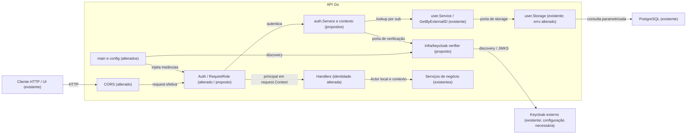
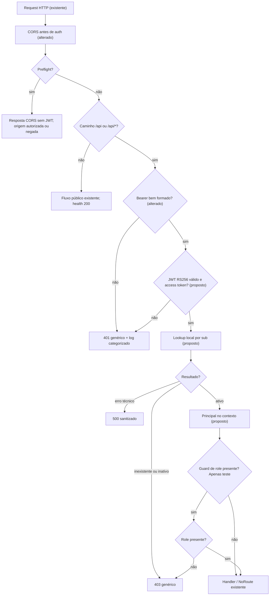
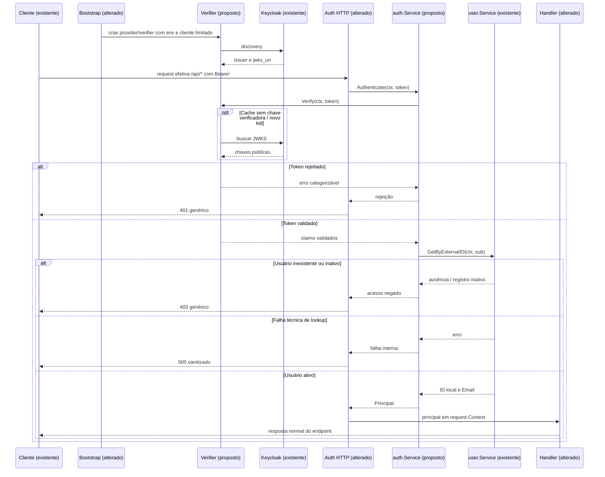

# ISSUE-1 — Autenticação JWT RS256 nos endpoints /api

## Objetivo

Validar access tokens do Keycloak em `/api/*`, disponibilizar claims e identidade local confiável no contexto da request e comprovar o comportamento por testes automatizados reproduzíveis.

## Contexto e decisões

Origem: issue fornecida pelo usuário, identificada como **Issue 1**, sem data/versão informada. `ISSUE-1` é apenas a normalização do identificador para os arquivos desta spec. Planejamento realizado em 2026-10-12. Estado: **aprovada pelo usuário para implementação com dev-mage em 2026-10-12**. Implementação em andamento, começando por T1; CI permanece fora do escopo conforme D5.

### Fatos verificados

| Evidência no repositório | Comportamento atual |
|---|---|
| `api/internal/infra/webserver/middleware/auth.go`, `Auth` | Bearer ausente recebe 401; Bearer presente recebe 501. Não há verificação de JWT. |
| `api/internal/infra/webserver/routes.go`, `Server.registerRoutes` | Rotas de negócio estão sob `/api/v1`; `/health` é público. |
| `api/internal/infra/webserver/server.go`, `NewServer` | Gin; CORS com origem `*`, `Authorization` permitido e credenciais habilitadas. Construção explícita dos serviços. |
| `api/internal/{guild,fixed_expense,transaction,importer}/handler.go`, `getRequesterActor` / `getRequesterUserID` | Identidade e e-mail de auditoria vêm de headers enviados pelo cliente. |
| `api/internal/user/service.go`, `Service.GetByExternalID`; `user.go`, `User`; `storage.go`, `postgresStorage.get` | Lookup por identificador externo já existe; usuário tem ID int64, ExternalID, Email e Enabled. Inexistência preserva `sql.ErrNoRows`, sem erro próprio de user. |
| `api/migrations/000001_create_users_table.up.sql`, tabela `user_account` | `external_id` é único; não é preciso criar coluna ou migration para o vínculo. |
| `api/internal/audit/audit.go`, `Actor` | Operações usam ID local numérico e e-mail para auditoria. |
| `api/config/config.go`, `Config`, `KeycloakConfig`, `Load` | Configuração atual usa base URL, realm, timeout e JWKSURI; exige `api/config.env`. Issuer, audience e origens CORS por env ainda não existem. |
| `api/go.mod`, blocos `go`, `require`, `tool` | Go 1.26.2, Gin, cors e testify; go-oidc/v3 não declarado. Linter disponível como Go tool. |
| `infra/docker-compose.yml`, serviço `keycloak` | Keycloak 26.7.5 em localhost:8080; sem import automático de realm/client ou fixture JWT no checkout. |
| `docs/specs/openapi.yaml`, `bearerAuth`, `UserIDHeader`, `UserEmailHeader`, `NotImplemented`, `ErrorResponse` | Contrato atual exige headers de identidade, documenta 501 e usa `{"error":"texto"}`. |
| `web/spa/src/app/session-provider.tsx`, `SessionProvider`; `src/mocks/request-context.ts`, `mockUserID` | Demonstração envia os headers antigos; mocks os utilizam. Integração real OIDC está pendente, conforme `web/spa/README.md`, seção API real. |
| `Makefile`, alvos `api/vet`, `api/lint`, `api/test`, `api/build`; `web/spa/package.json`, scripts `api:types`, `api:types:check` | Gates backend e geração de tipos estão definidos; não foi encontrada configuração de CI no checkout. |

As regras lidas são `AGENTS.md` e `docs/go/{architecture,coding,naming}.md`. Os caminhos alternativos `.standards/go/*` e `../docs/go/*` citados pelo AGENTS não existem neste checkout; os documentos efetivamente disponíveis em `docs/go/` fundamentam esta proposta. Não foi encontrado CLAUDE.md aplicável.

### Decisões confirmadas na entrevista

| Decisão | Confirmação | Definição |
|---|---|---|
| D1 | Q1 | Audience de referência `guild-banker-api`, lida de `API_AUDIENCE`; corrigir a referência divergente `api-golang` em API-CA5. Usar coreos/go-oidc/v3, sem adicionar jwt/v5. |
| D2 | Q2 | Implementar HasRole/RequireRole; testar member/admin em rota exclusiva dos testes. Não aplicar roles às rotas de negócio. |
| D3 | Q3 | Incluir vínculo seguro `sub → usuário local` e remover a confiança em X-User-ID/X-User-Email nos quatro módulos de handlers. |
| D4 | Q4 | Capturar JWT e JWKS público de realm local isolado, com identidade fictícia. Relógio fixo somente nos testes; testes regulares independentes de Keycloak ativo. Rotação com servidor OIDC/JWKS de teste. |
| D5 | Resposta a Q5 | Criação/configuração de CI fica para outra issue. Não implementar pipeline nem declarar a cláusula remota de API-CA9 atendida. |
| D6 | Q6 | Usuário local inexistente ou desativado recebe 403 genérico; cadastro prévio obrigatório, sem provisionamento automático. ID e e-mail de auditoria vêm do registro local. |
| D7 | Q7 | CORS por allowlist em env, Authorization permitido, preflight antes da autenticação, health público, envelope JSON preservado, somente access tokens. Falha de discovery impede startup; falta de chave válida e falha de JWKS rejeitam a request. |

### Critérios de aceite

CA1–CA8 correspondem a API-CA1–API-CA8 da issue, com os esclarecimentos aprovados. CA10–CA14 tornam verificáveis as tarefas da issue e as decisões da entrevista. **Esclarecimento técnico proposto para aprovação final:** os CAs de autenticação HTTP consideram requests sem Origin ou com origem CORS autorizada. Por D7, CORS precede auth; origem negada pode receber 403 da biblioteca antes do JWT, e esse cenário pertence a CA11, não à resposta 403 de usuário/role.

- **CA1:** Request sob `/api/*` que passa pela política CORS, sem Authorization, recebe 401 e não executa handler. Inclui request sem Origin e rota inexistente; `/health` e preflight CORS são exceções aprovadas.
- **CA2:** Access token válido, com usuário local ativo previamente cadastrado, chega ao handler de prova e recebe 200; UserID externo, PreferredUsername, RealmRoles e ator local estão disponíveis em request.Context. Rotas reais preservam seus próprios status de sucesso.
- **CA3:** Assinatura por chave não confiável, payload adulterado ou issuer diferente recebe 401.
- **CA4:** Token expirado recebe 401; validação de exp não pode ser desabilitada.
- **CA5:** Token cujo aud não contém API_AUDIENCE recebe 401, mesmo que azp corresponda ao client esperado. aud ausente é rejeitado; aud string/array contendo a audience é aceito.
- **CA6:** Em rota criada exclusivamente para teste, token autenticado sem a role exigida recebe 403; com a role recebe 200. Nenhuma rota de negócio ganha requisito de role.
- **CA7:** O mesmo verifier aceita novo token após publicação de novo kid no JWKS, sem restart; chave conhecida utiliza cache. kid desconhecido sem chave correspondente continua rejeitado.
- **CA8:** Tokens com alg diferente de RS256, incluindo none, HS256 e outro algoritmo assimétrico, recebem 401.
- **CA9 — recorte aprovado:** Suíte local automatizada cobre CA1–CA8 com fixtures. **A exigência original de execução no CI foi adiada para outra issue por D5 e não será considerada concluída nesta entrega.**
- **CA10:** sub resolve usuário local por ExternalID; ator usa ID/Email locais e ignora headers conflitantes. Usuário inexistente/inativo recebe 403; falha técnica do lookup recebe 500 sanitizado. Token inválido não consulta usuário. Não há cadastro automático.
- **CA11:** Origens CORS são explícitas por env; origem não permitida não obtém acesso CORS. Preflight autorizado permite Authorization e não exige JWT; request efetiva continua exigindo autenticação.
- **CA12:** KEYCLOAK_ISSUER e API_AUDIENCE vêm de env, sem valor de realm/client hardcoded no código; timeout existente limita IO. Configuração inválida ou discovery indisponível impede a API de iniciar.
- **CA13:** Falhas de auth retornam envelope genérico consistente e produzem logs slog com motivo categorizado, sem token, claims, PII ou erro bruto da biblioteca.
- **CA14:** ID token e refresh token não são aceitos como access token, mesmo com assinatura/issuer/audience válidos; sub é obrigatório. Roles ausentes não impedem autenticação de rota sem role guard.

## Fora do escopo

- Pipeline, GitHub Actions e execução remota dos testes; abertura automática da issue de CI.
- Autorização por role em rotas de negócio, alteração das verificações de membership/ownership já existentes, ou implicação automática admin → member.
- Login/logout/refresh da SPA, onboarding, sincronização/cadastro automático de usuários e alterações dos mocks de demonstração.
- Introspection, revogação imediata, DPoP, cache de usuários, rate limiting e suporte a outro issuer/algoritmo.
- Migrations, reorganização dos módulos, atualização geral de Go ou alteração do realm compartilhado.
- Push, PR, publicação ou execução de serviços durante este planejamento.

## Premissas e riscos

| # | Classificação e descrição | Evidência/motivo | Impacto e validação |
|---|---|---|---|
| P1 | **Premissa operacional:** usuário local já cadastrado com ExternalID igual ao sub. | D3/D6; `user_account.external_id` e `Service.GetByExternalID`. | Sem esse vínculo a resposta é 403. Testes usam usuário fictício; implantação depende de cadastro por fluxo externo a esta issue. |
| P2 | **Premissa operacional:** realm emite RS256 e inclui audience da API nos access tokens. | D1; configuração de realm/client ausente no checkout. | Verificar mapper de audience no ambiente e documentar o preparo do realm isolado; nunca relaxar aud para compensar configuração incorreta. |
| P3 | **Lacuna não bloqueante:** domínio da UI em produção não informado. | `web/spa/README.md`, modos/API real. | Env obriga allowlist explícita; exemplo local usa localhost:5173 e 127.0.0.1:5173. Preview 4173 só entra por configuração explícita. |
| P4 | **Fato verificado / risco operacional:** config.Load exige arquivo env local. | `api/config/config.go`, `envFile`/`Load`. | T2 torna o arquivo opcional quando ausente, preservando env como fonte e retornando erros de leitura/configuração. Não refatorar as configurações de banco. |
| P5 | **Premissa operacional:** captura da fixture usa Keycloak isolado com versão compatível com 26.7.5. | D4; serviço Keycloak em `infra/docker-compose.yml`. | T6 requer Docker/Keycloak apenas para a captura inicial. Replay automatizado não depende deles. Capturar JWT emitido e chave pública; nunca exportar chave privada real. |
| P6 | **Fato verificado:** Go e mmdc não estão no PATH desta sessão; raiz pede Go 1.27.1, API pede 1.26.2. | Verificação de ferramentas; `.tool-versions`, `api/.tool-versions`, `api/go.mod`. | Nenhum teste/build foi executado no planejamento. Implementação utiliza toolchain compatível com o módulo; correção da versão raiz fica fora do escopo. Mermaid sem validação. |
| P7 | **Fato verificado / limitação:** SPA demo ainda envia headers antigos. | `SessionProvider` e `mockUserID`. | Backend ignora esses headers; CORS não os libera. Integração cross-origin real da SPA precisará removê-los em outra issue. Somente tipos gerados mudam aqui. |
| P8 | **Risco residual:** uma chave antiga pode permanecer no cache enquanto válida para o verifier. | Contrato RemoteKeySet; revogação imediata fora do escopo. | CA7 prova refresh por novo kid; não promete invalidar imediatamente todos os tokens antigos. Falha remota só permite continuar quando assinatura passa com chave já confiável em cache. |

## Arquitetura da solução

### Visão geral

**Proposta:** feature `internal/auth` contém os valores de identidade, acesso ao contexto e serviço de autenticação. O serviço consome interfaces estreitas de verificação e lookup de usuário definidas no próprio consumidor. `*user.Service` existente satisfaz o lookup. O adapter **proposto** `internal/infra/keycloak` encapsula go-oidc, DTOs JSON do JWT, discovery e JWKS. O middleware HTTP **alterado** traduz erros, injeta o principal e interrompe requests rejeitadas. Domínios de usuário/guild/despesas/transações/importação não importam Keycloak ou Gin.

**Proposta de contratos internos, a criar:**

- `auth.Claims`: UserID string = sub externo; PreferredUsername string; RealmRoles []string. Sem tags de transporte. Claims opcionais ausentes não causam panic; tipos incompatíveis são rejeitados pelo adapter.
- `auth.Principal`: Claims e Actor (`audit.Actor`, ID int64 e Email do usuário local). Não converter UUID/sub em inteiro nem mapear usuário por email/username.
- `auth.WithPrincipal` / `auth.PrincipalFromContext` / `auth.ClaimsFromContext`: acesso tipado com chave de contexto privada, preservando cancelamento/deadline do contexto original. Nenhum gin.Context ou DTO OIDC chega aos serviços de negócio.
- `auth.Claims.HasRole`: igualdade exata com realm_access.roles; member/admin são valores conhecidos, sem hierarquia implícita. Roles extras do Keycloak podem ser preservadas, sem conferir autorização adicional.
- `auth.Service.Authenticate`: verifica token antes de consultar `user.Service.GetByExternalID`; retorna principal ou erro categorizável. Sem consultas/repositórios diretos no middleware.
- `user.ErrNotFound` **proposto:** adapter SQL traduz ausência de linha para erro da feature, preservando a cadeia necessária aos consumidores existentes. Auth reconhece com errors.Is; nunca importa database/sql ou compara mensagens.

Esses nomes são **propostas de implementação**, não APIs existentes. Interfaces só nas duas fronteiras usadas pelo serviço e pelo middleware para DI/testes; não criar wrappers genéricos, factory global ou interface para cada struct.

### Verifier e configuração

**Decisão D1 / proposta técnica:** construir provider por discovery a partir de KEYCLOAK_ISSUER e verifier com `oidc.Config{ClientID: audience, SupportedSigningAlgs: []string{oidc.RS256}}`; manter checks de assinatura/issuer/audience/exp habilitados. `AllowedSigningAlgs` não é o nome do campo desta biblioteca. A API do verifier é denominada IDTokenVerifier; após verificação, o adapter ainda exige semântica de access token Keycloak (`typ` do payload igual a Bearer) e sub não vazio. O `typ` do cabeçalho JOSE não substitui essa checagem. Referências: [API oficial go-oidc](https://pkg.go.dev/github.com/coreos/go-oidc/v3/oidc) e [checagens padrão do Keycloak 26.7.5](https://raw.githubusercontent.com/keycloak/keycloak/26.7.5/core/src/main/java/org/keycloak/TokenVerifier.java). A fixture usa emissão Bearer padrão; configuração avançada de tipo em minúsculas/DPoP não é suportada nesta proposta.

| Variável | Contrato proposto |
|---|---|
| KEYCLOAK_ISSUER | Obrigatória. URL exata do issuer; exemplo apenas no env/documentação: `http://localhost:8080/realms/guild-banker`. Não remover barra final silenciosamente nem desabilitar comparação de issuer. |
| API_AUDIENCE | Obrigatória e não vazia. Exemplo: `guild-banker-api`. Comparar aud, não azp. |
| KEYCLOAK_TIMEOUT_SECONDS | Reutilizar configuração existente, positiva, default local já existente de 5s; limita discovery/JWKS e espera de autenticação/lookup. |
| CORS_ALLOWED_ORIGINS | Adicionada em T5. Lista por vírgulas de origens completas, sem wildcard; obrigatória na configuração final. Exemplo: `http://localhost:5173,http://127.0.0.1:5173`. |

KEYCLOAK_ISSUER é a fonte de verdade. Os campos antigos BaseURL/Realm/JWKSURI deixam de orientar autenticação; manter sua superfície existente enquanto não precisar removê-la, mas não exigir os envs antigos nem construir fallback divergente. Não alterar DBConfig/DSN ou credenciais.

**Proposta de lifecycle:** main constrói logger, cliente HTTP com Timeout, provider/verifier e auth.Service antes de aceitar requests; injeta o serviço no servidor. Discovery limitado por contexto, erro propagado ao bootstrap. Verifier/cache vive por instância da API, nunca por request. Verificação e lookup recebem contexto derivado da request com timeout; cancelamento é propagado. RemoteKeySet pode concluir fetch compartilhado independentemente da request cancelada; o timeout do cliente HTTP limita esse trabalho. Sem goroutines próprias de refresh ou segundo cache. API oficial: [RemoteKeySet e implementação](https://github.com/coreos/go-oidc/blob/v3/oidc/jwks.go).

### HTTP, identidade, erros e observabilidade

**Alterado:** autenticação cobre a fronteira de caminho `/api` ou `/api/`, incluindo NoRoute; `/apix` não corresponde. CORS executa antes dela. `/health` permanece público. OPTIONS de preflight é tratado por CORS e não chega à autenticação; OPTIONS efetivo que não seja preflight não ganha bypass geral. Não criar rota pública de diagnóstico/claims.

**Alterado:** os quatro handlers leem principal do request.Context e passam Actor local para os serviços existentes. Headers X-User-ID/X-User-Email não têm fallback nem são sobrescritos para simular confiança. Falta de principal aborta com 401. As regras de negócio existentes continuam nos serviços.

**Proposto:** RequireRole usa claims já autenticados; sem principal retorna 401, sem role retorna 403. Apenas a suíte registra uma rota com esse guard. Não alterar 403 de membership/ownership fora do escopo.

| Situação | HTTP / corpo |
|---|---|
| Authorization ausente/malformado, JWT inválido/expirado, issuer/aud/alg/type/sub inválidos, JWKS indisponível sem chave válida | `401 {"error":"unauthorized"}`; header WWW-Authenticate com desafio Bearer genérico, sem detalhes. |
| Usuário local inexistente/inativo; falta da role na rota de teste | `403 {"error":"forbidden"}`. |
| Falha técnica no lookup local | `500 {"error":"internal server error"}`; não confundir erro de banco com token inválido ou usuário inexistente. |

**Proposta de logs:** injetar *slog.Logger; evento fixo de rejeição com status e reason de vocabulário fechado, como missing_token, malformed_authorization, invalid_token, token_expired, invalid_token_type, missing_subject, user_not_found, user_disabled e missing_role. Categorias específicas somente quando houver tipo de erro/checagem controlada; demais falhas do verifier usam invalid_token. Não inspecionar texto de erros go-oidc para distinguir assinatura/issuer/aud, nem logar o erro bruto. Sem token/header/payload/sub/username/email/IP/query string. Log do lookup técnico também omite erro bruto possivelmente sensível; não duplicar logs entre adapter, serviço e middleware.

**Proposta CORS:** origens exatas, sem wildcard, Authorization/Content-Type/Origin permitidos, métodos existentes e preflight OPTIONS. AllowCredentials false, pois a API usa Bearer e não cookies. Sem headers de identidade liberados. Origem negada pode receber status definido pela biblioteca, porém não obtém Access-Control-Allow-Origin autorizador; CORS não substitui validação JWT.

### Diagrama arquitetural

### Fluxograma

### Jornada e sequência

Cliente envia access token. API autentica, resolve o usuário local e só então permite que o handler execute seu comportamento normal. Todos os participantes/fluxos de auth abaixo são propostos ou alterados; infraestrutura externa e serviços de usuário já existem.

### Rastreabilidade

| CA | Fluxo/decisão | Tasks |
|---|---|---|
| CA1–CA2 | Bearer, contexto e ativação HTTP | T1, T3, T4 |
| CA3–CA5, CA8, CA14 | Verifier RS256, claims, semântica access token | T2, T4 |
| CA6 | HasRole e guard exclusivo de teste | T1, T4 |
| CA7 | Cache/refresh de JWKS na mesma instância | T2, T4 |
| CA9 local | Fixtures sintéticas e real, testes reproduzíveis | T2, T4, T6 |
| CA9 remoto | Execução CI | Outra issue, conforme D5 |
| CA10 | Lookup local e abandono de headers | T3, T4 |
| CA11 | Allowlist e preflight | T5 |
| CA12 | Env, bootstrap e limites de IO | T2, T4, T5 |
| CA13 | Envelope, categorização e logs sem PII | T1, T2, T3, T4 |

Sem ambiguidade bloqueante após Q1–Q7. Escolhas técnicas nesta seção permanecem **propostas** até aprovação final. **Sintaxe Mermaid não validada**: mmdc não disponível.

## Estratégia de testes e fixtures

**Proposta:** unitários usam testing + testify existentes, mocks estreitos nas portas e testes por tabela. Testes HTTP/discovery/JWKS recebem `//go:build integration`; T2 acrescenta alvo local de integração. A suíte de integração usa httptest e usuários locais stubados, sem subir o binário nem usar banco/Keycloak compartilhados. Um driver de teste da stdlib pode exercitar a tradução de sql.ErrNoRows no storage, sem adicionar sqlmock/testcontainers.

Fixtures sintéticas são assinadas por chaves RSA exclusivas de teste, com claims controlados e relógio fixo. Usar stdlib para assinatura de teste; não adicionar outra biblioteca JWT só para gerar fixtures. Nenhuma chave privada do realm é necessária. O ponto de construção/injeção do relógio permanece privado em infra/keycloak; testes HTTP que precisam do verifier/relógio real ficam nesse pacote e importam auth.Service e o middleware, sem ciclo de dependência. Testes de prefixo/CORS em webserver não precisam acessar esse relógio.

T2 prova cache aquecido com kid A, publica chave B no servidor de teste, valida token B no mesmo verifier e rejeita kid C desconhecido. T4 repete os cenários pelo HTTP e prova CA1–CA8 no comportamento externo, com registro de invocações do handler e lookup. T6 acrescenta compatibilidade com JWT realmente emitido pelo Keycloak; não é task de testes finais genéricos.

**Fixture real proposta:** token original de usuário fictício, JWKS público e metadados de captura/issuer/audience/versão/instante de verificação. Replay usa relógio dentro de iat/exp e novamente após exp, sem SkipExpiryCheck. Teste usa key set público local com issuer original, ou transporte de teste que encaminha apenas URLs conhecidas para httptest; não editar o JWT assinado nem desabilitar issuer/signature/audience. Discovery e refresh são exercitados separadamente com provider de teste. Metadados e README documentam a captura num ambiente isolado sem credenciais pessoais, export de chave privada ou modificação do realm compartilhado.

## Arquivos impactados

Todos os arquivos futuros abaixo são **propostos**; testes com nomes definidos nas tasks também são planejados.

- [criar] `api/internal/auth/{claims,context,errors,service}.go` e respectivos `*_test.go` — valores, contexto, rejeições e serviço/portas.
- [criar] `api/internal/infra/keycloak/verifier.go`, `verifier_test.go`, `verifier_integration_test.go`, `verifier_http_integration_test.go` — adapter OIDC, verifier, JWKS e aceitação HTTP com relógio privado de teste.
- [alterar] `api/config/config.go`, `api/config.env.example`, `api/go.mod`, `api/go.sum`, `Makefile` — env, dependência e alvo local de integração.
- [criar] `api/config/config_test.go` — contratos de config/env e allowlist.
- [criar] `api/internal/user/errors.go`, `storage_test.go`; [alterar] `user/storage.go`, `user/service_test.go` — erro de inexistência e propagação.
- [alterar] `api/internal/infra/webserver/middleware/auth.go`; [criar] `auth_test.go`, `auth_integration_test.go`, `roles.go`, `roles_test.go` no mesmo diretório — HTTP, role guard e logs.
- [alterar] `api/internal/infra/webserver/{server,routes}.go`, `api/cmd/server/main.go`; [criar] `server_integration_test.go`, `routes_integration_test.go` — bootstrap, DI, proteção de prefixo e CORS.
- [alterar] `api/internal/{guild,fixed_expense,transaction,importer}/handler.go`; [criar] respectivos `handler_test.go` — identidade confiável.
- [alterar] `docs/specs/openapi.yaml`, `docs/specs/OPENAPI_GAPS.md`, `web/spa/src/shared/api/schema.d.ts` — contrato e artefato gerado, sem reescrever UI/demo.
- [criar] `api/internal/infra/keycloak/testdata/keycloak/{access-token.jwt,jwks.json,metadata.json,README.md}`, `verifier_keycloak_integration_test.go` — captura fictícia e replay real.

## Tasks

| Task | Título | Status | Depende de | Arquivo |
|---|---|---|---|---|
| T1 | Claims e contexto tipados | ✅ concluida | nenhuma | [T1](./ISSUE-1-T1-claims-contexto.md) |
| T2 | Verifier OIDC e configuração | ✅ concluida | T1 | [T2](./ISSUE-1-T2-verifier-oidc.md) |
| T3 | Vínculo com usuário local | ✅ concluida | T1, T2 | [T3](./ISSUE-1-T3-identidade-local.md) |
| T4 | Ativação HTTP e abandono dos headers | ✅ concluida | T1, T2, T3 | [T4](./ISSUE-1-T4-autenticacao-http.md) |
| T5 | CORS restrito e preflight | ⬜ pendente | T4 | [T5](./ISSUE-1-T5-cors-restrito.md) |
| T6 | Fixture de access token Keycloak real | ⬜ pendente | T2, T4, T5 | [T6](./ISSUE-1-T6-fixture-keycloak.md) |

Cada task deixa build/testes/lint passando. Até T3 o middleware existente continua 401/501; T4 ativa auth e troca a fonte de identidade dos quatro módulos no mesmo commit. Não deixar estado intermediário aceitando JWT e identidade fornecida por headers.

## Verificação final

### Comandos e pré-requisitos

**Fatos verificados:** os quatro gates abaixo existem no Makefile. A ordem vet → lint → testes segue os pré-requisitos do alvo check; build é o gate adicional api/build. Executar na raiz do monorepo com toolchain compatível com `api/go.mod` (1.26.2), suporte a race e dependências acessíveis. Os testes não devem depender de api/config.env, PostgreSQL ou Keycloak ativos.

1. `make api/vet` — esperado: nenhuma falha nova nos pacotes afetados.
2. `make api/lint` — esperado: linter Go tool passa.
3. `make api/test` — esperado: unitários passam com race e count=1.
4. `make api/test/integration` — **alvo proposto, inexistente hoje, criado em T2**; executa `go test ./... -race -count=1 -tags=integration` em api. Sintaxe de build tags documentada no [comando Go oficial](https://pkg.go.dev/cmd/go#hdr-Build_constraints). Esperado: suíte HTTP/JWKS/fixture real passa sem serviços externos.
5. `make api/build` — esperado: binário compila; não executá-lo contra banco compartilhado.

Após mudança de OpenAPI em T4: `npm --prefix web/spa run api:types` regenera tipos; `make web/types` verifica drift; `make web/build` verifica compilação dos consumidores. Comandos existentes em Makefile/package.json, com Node compatível com >=22.12 e dependências já instaladas. Nenhuma mudança de comportamento da SPA é planejada; E2E de demonstração não comprova auth real e não é gate desta issue backend.

Captura da fixture real em T6 requer Keycloak isolado; comandos específicos de criação/captura ainda não foram executados e serão documentados no README da fixture após validação. Não executar infra/clean, reset de banco, migration ou export de realm compartilhado. Não há gate CI nesta issue.

### Matriz CA → task → evidência esperada

| CA | Tasks | Evidência esperada (não obtida no planejamento) |
|---|---|---|
| CA1 | T4 | HTTP 401 sem Bearer em requests sem Origin/permitidas, inclusive NoRoute /api; nenhuma invocação de handler/lookup. |
| CA2 | T1, T3, T4, T6 | HTTP 200 no handler de prova, claims via request.Context, Actor local correto; replay da fixture real. |
| CA3 | T2, T4 | HTTP 401 para chave externa, assinatura/payload adulterado e issuer errado. |
| CA4 | T2, T4, T6 | HTTP 401 expirado; fixture real válida em instante fixo e rejeitada após exp. |
| CA5 | T2, T4 | aud ausente/incorreto rejeitado; string/array correto aceito; azp não substitui aud. |
| CA6 | T1, T4 | Role guard de teste: 401 sem principal, 403 sem role, 200 com role; rotas reais sem novo guard. |
| CA7 | T2, T4 | Verifier/servidor preservado entre requests; kid B aceito após mudança JWKS; cache A usado; C rejeitado. |
| CA8 | T2, T4 | 401 para none, HS256 e algoritmo assimétrico não permitido. |
| CA9 local | T2, T4, T6 | Alvos unitários/integration executam CA1–CA8 e fixture real de forma reproduzível. |
| CA9 remoto | nenhuma | Adiado para outra issue; sem evidência de CI exigida ou alegada aqui. |
| CA10 | T3, T4 | Lookup por sub, ID/Email locais em cada família de handler, headers de B ignorados; inexistente/inativo 403, técnico 500, inválido sem lookup. |
| CA11 | T5 | Preflight sem JWT autoriza Authorization apenas nas origens permitidas; origem externa sem permissão CORS; GET efetivo401 sem token. |
| CA12 | T2, T4, T5 | Env/config validadas; discovery falho/issuer divergente impede inicialização; timeout e cancelamento observáveis. |
| CA13 | T1–T4 | Mesmo envelope em todos os erros de auth e mesmo corpo entre motivos que resultam no mesmo status; slog com reason fechado e sem segredos/PII inseridos no teste. |
| CA14 | T2, T4 | 401 para ID/refresh token ou sub ausente; ausência de roles aceita em rota sem guard. |

### Revisão do planejamento

- Requisitos: CA1–CA8 e CA10–CA14 possuem tasks; CA9 local coberto, CI explicitamente transferido por D5.
- Engenharia: dependências só para trás, sem migration/refactor geral; contexto/identidade separados do adapter OIDC; ativação HTTP atômica em T4.
- Qualidade: cada task tem testes e critérios próprios, caminhos futuros marcados criar, gates existentes separados do alvo novo, evidência futura não descrita como teste executado.
- Convenções: nenhuma biblioteca extra JWT, domínio sem DTO, interfaces no consumidor, errors.Is/As e %w, slog sanitizado, sem globals/goroutines próprias de refresh.
- Documentação: seis tasks pendentes, links relativos em ambos os sentidos; três diagramas com sintaxe não validada.

## Decisões

<!-- Preenchido pelo dev-mage durante a implementação: aprovação final, escolhas locais, evidências e desvios explicitamente autorizados. -->
