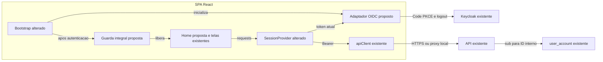
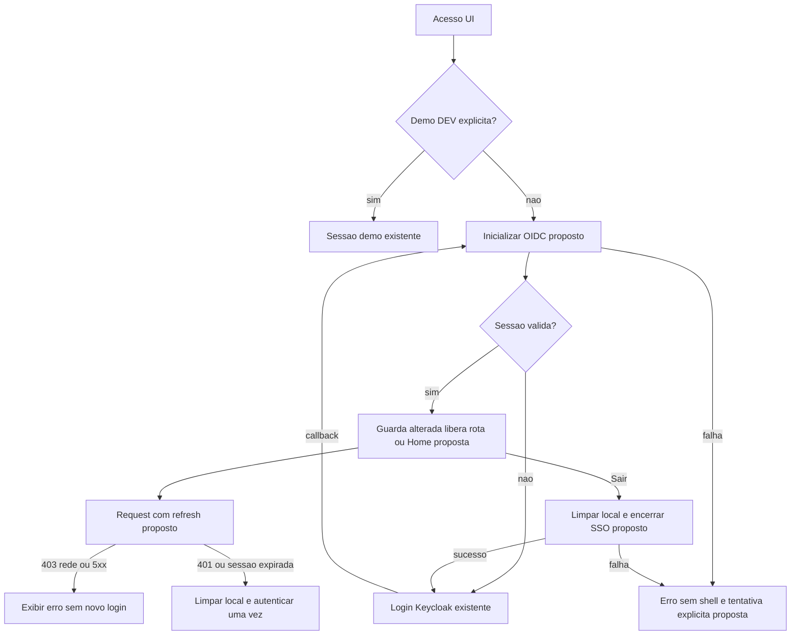
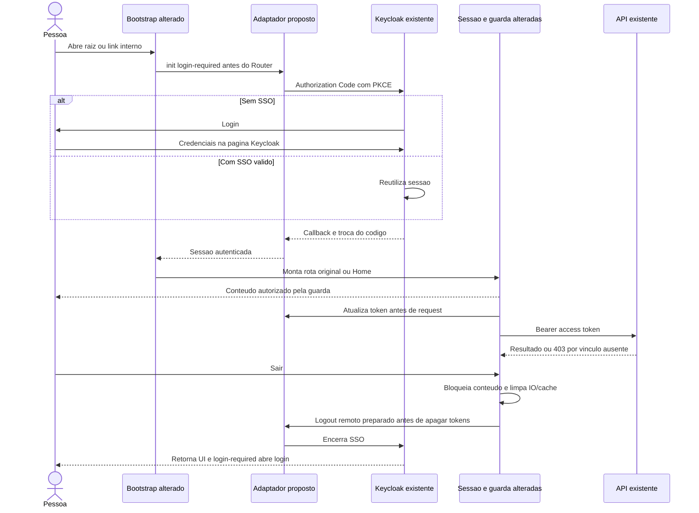

# ISSUE-2 — Autenticação React com Keycloak

## Objetivo
Integrar a SPA ao Keycloak, proteger a aplicação inteira e oferecer Home mínima e logout integrado.

## Contexto e decisões
Origem: descrição fornecida pelo usuário nesta conversa; refinamento de 2026-11-01. Estado: aprovada explicitamente pelo usuário; implementação autorizada com dev-mage.

**Fatos verificados:**
- `web/spa/src/main.tsx`, `bootstrap`: usuário inicial somente em DEV com mocks; não inicia OIDC.
- `web/spa/src/app/app.tsx`, `AppRoutes`/`protectedPage`: raiz vai a despesas fixas; ausência de sessão mostra mensagem. `App` monta Header/Sidebar sem sessão.
- `web/spa/src/shared/components/sidebar.tsx`, `Sidebar`: item `nav.home` aponta para `/`.
- `web/spa/src/app/session-provider.tsx`, `SessionUser`/`SessionProvider.request`/`logout`: ID numérico, headers de demo, token opcional; logout/401 aborta IO e limpa cache local. Controller precisa ser recriado numa nova sessão.
- `api/internal/auth/service.go`, `Authenticate`: resolve `claims.UserID` por `GetByExternalID`; cadastro ausente/inativo é rejeitado. `api/internal/infra/webserver/middleware/auth.go`, `Auth`: 401/403/500. A observação de 501 no README da SPA está desatualizada.
- `infra/keycloak/guild-banker-clients.json`, client `guild-banker-ui`: público, Standard Flow, PKCE S256, origins/redirects locais 5173 e audience guild-banker-api. `infra/keycloak/README.md`: reimportação ignora realm existente.
- `web/spa/package.json`: não contém SDK OIDC; possui lint, build, Vitest, Playwright demo/prod e check de tipos.

**Decisões confirmadas pelo usuário:** D1 ID ISSUE-2, descrição original como conteúdo (Q1). D2 client guild-banker-ui (Q2). D3 login direto no Keycloak, retorno ao deep link e nova /home como padrão pós-login, saudação mínima no item Início (Q3, com correção do destino original). D4 refresh, expiração e logout da aplicação e Keycloak pelo botão UI (Q4). D5 cadastro automático fica como follow-up (Q5).

**Critérios de aceite** (CA2/CA7/CA8 detalham tecnicamente a proteção e compatibilidade propostas; sujeitos à aprovação desta spec):
- **CA1:** Sem sessão válida, acessar a raiz ou qualquer rota interna redireciona ao login Keycloak do client guild-banker-ui, realm guild-banker; sessão SSO existente pode dispensar nova digitação.
- **CA2:** Enquanto verifica/autentica ou diante de erro de autenticação, nenhum shell/tela interna ou request financeiro é liberado; erros oferecem recuperação sem loop.
- **CA3:** Após login pela raiz, abrir /home; Início aponta para /home e exibe apenas “Bem-vindo(a) <nome da pessoa>” como conteúdo da página, sem exigir guild selecionada.
- **CA4:** Login iniciado por link interno retorna à mesma rota e query de negócio; recarga restaura sessão via Keycloak sem persistir tokens no storage.
- **CA5:** Requests reais usam access token atual, com renovação automática; expiração sem recuperação exige login, sem repetir mutations automaticamente.
- **CA6:** Sair na UI encerra sessão local e sessão SSO no Keycloak; IO/cache são limpos e histórico não reexibe conteúdo interno sem autenticação.
- **CA7:** 401 encerra a sessão local e conduz à reautenticação; 403 (incluindo cadastro local ausente/inativo), rede e 5xx não provocam loop de login.
- **CA8:** Demonstração permanece opt-in somente DEV; produção não usa identidade/mock/headers de demo. Configuração pública e procedimento de integração real ficam documentados.

## Fora do escopo
Cadastro/provisionamento automático de user_account (follow-up solicitado), endpoint /me, alterações de regras de autorização da API, BFF, tela pública própria de login, tema Keycloak, dashboard além da saudação, deploy e mudanças gerais da toolchain.

## Premissas e riscos
| # | Descrição | Evidência/motivo | Impacto | Validação/mitigação | Situação |
|---|---|---|---|---|---|
| P1 | Identidade real no frontend usa sub textual; demo mantém ID numérico | SessionUser atual vs Authenticate na API | Keys hoje aceitam number | Ampliar somente identidade de cache para string ou number; nunca confundir com IDs internos | proposta técnica |
| P2 | Usuário de teste já possui vínculo ativo na API | Authenticate e README Keycloak | Login pode funcionar e API devolver 403 | Conferir vínculo previamente; não criar cadastro nesta issue | premissa operacional |
| P3 | SDK keycloak-js direto, sem wrapper | Adaptador oficial e ausência de dependência atual | Nova dependência | Confirmar versão compatível, lockfile e teste real | proposta técnica |
| P4 | Runtime local tem realm/client corretos | Importação SKIP não atualiza existentes | Callback/logout pode ser recusado | Conferir console; documentar alteração pontual de post-logout URI sem overwrite | premissa operacional |
| P5 | Tokens somente memória; SSO restaura após reload | Documentação oficial | Redirect ao recarregar; restrições de cookies afetam iframe | Não depender de silent iframe; validar SSO real | proposta técnica |
| P6 | Home usa nome OIDC com fallback para preferred_username e saudação sem nome | Claims podem ser opcionais | Evitar nome vazio/undefined | Testar fallback e interpolação textual | proposta técnica |
| P7 | HTTPS e origens definitivas serão configurados no hosting futuro | Repo só configura origens locais | Validação local não comprova produção hospedada | Documentar redirects/origins precisos e fallback SPA, sem publicar | risco não bloqueante |

## Arquitetura da solução

### Visão geral
**Existentes:** SPA estática, React Router, Context de sessão, TanStack Query, cliente fetch, modo demo DEV, API Bearer e Keycloak. **Alterados:** bootstrap, sessão, guarda anterior ao shell, cache keys, Início e raiz. **Propostos:** Home e adaptador fino sobre keycloak-js, possuído pelo bootstrap e injetado na sessão, sem singleton mutável ou novo backend.

Inicializar OIDC antes do Router com `onLoad: login-required`, Code + PKCE S256. Não transportar senha pela SPA. Tokens permanecem na memória do SDK e não nas claims do usuário, URLs, storage ou logs. O provider obtém token atual antes de IO; refresh concorrente compartilha operação. Demo só usa headers X-User quando DEV e opt-in. `sub` identifica sessão/cache; a API continua resolvendo ID interno e autorização.

A guarda abrange shell, conteúdo e wildcard; loading/erro não monta consultas. Após autenticação, raiz segue à Home e links diretos voltam à rota original. Não criar returnTo arbitrário externo. Nome vem de claims para apresentação, sem usá-las como prova de autorização de domínio.

Logout voluntário prepara encerramento remoto e limpa sessão local sem corrida com re-login. Redirecionar de volta à raiz após logout dá início ao fluxo login-required já sem SSO. Erros remotos não permitem afirmar que SSO foi encerrado; sessão local permanece fechada. 401 não faz logout global automático; 403 não autentica novamente. Cancelar callbacks/IO e limpar Query em toda transição terminal; nova sessão tem novo controller. Não há persistência/transações novas.

Base técnica: [adaptador JavaScript oficial do Keycloak](https://www.keycloak.org/securing-apps/javascript-adapter), consultado em 2026-11-01: login-required, inicialização antes do router, Bearer, updateToken e tokens somente memória. A guarda UX complementa a proteção já existente na API.

### Diagrama arquitetural

### Fluxograma

### Jornada

Sintaxe Mermaid não validada: mmdc não encontrado. Incertezas restantes são operacionais/técnicas propostas acima; nenhum requisito de negócio bloqueante conhecido.

## Arquivos impactados
Caminhos existentes confirmados durante investigação; novos marcados como [criar]. Relação completa e finalidade por task abaixo. Apenas docs/specs são escritos neste planejamento.

## Tasks
| Task | Título | Status | Depende de | Arquivo |
|---|---|---|---|---|
| T1 | Criar Home e navegação inicial | ✅ concluida | nenhuma | [T1](./ISSUE-2-T1-home.md) |
| T2 | Preparar adaptador OIDC e configuração | ✅ concluida | T1 | [T2](./ISSUE-2-T2-adaptador-oidc.md) |
| T3 | Conectar sessão real e guarda integral | ✅ concluida | T2 | [T3](./ISSUE-2-T3-guarda-sessao.md) |
| T4 | Completar renovação, expiração e logout | ✅ concluida | T3 | [T4](./ISSUE-2-T4-ciclo-sessao.md) |
| T5 | Validar jornada real com Keycloak | ⬜ pendente | T4 | [T5](./ISSUE-2-T5-integracao-real.md) |

## Verificação final
Comandos confirmados em `web/spa/package.json`, `Makefile` e `web/spa/README.md`. Na raiz, seguir gate documentado: `npm --prefix web/spa ci` → `npm --prefix web/spa run api:types:check` → `npm --prefix web/spa run lint` → `npm --prefix web/spa run build` → `npm --prefix web/spa test` → `npm --prefix web/spa run test:e2e` → `npm --prefix web/spa run test:e2e:prod`. Instalar Chromium conforme README. Não existe gate remoto CI verificado. Backend build/test: não aplicável se nenhum Go for alterado, pois esta issue não muda API.

T2 usa também `make keycloak/validate`, confirmado, somente leitura de definições. T5 cria script `test:e2e:auth`, ainda proposto. Teste real requer infraestrutura/credencial/vínculo corretos, não apenas containers disponíveis. Porta 4173 do smoke não consta no client real: smoke intercepta OIDC; teste real usa 5173. Hosts definitivos/HTTPS ficam como premissa do deploy futuro. Não executar infra/clean ou operações destrutivas.

| CA | Tasks | Evidência esperada |
|---|---|---|
| CA1 | T2, T3, T5 | Guarda por rota e login real no client correto; SSO sem nova senha |
| CA2 | T3, T5 | Sem shell/IO antes de autenticar; erro recuperável sem loop |
| CA3 | T1, T3, T5 | Menu/raiz levam à Home com nome real; Home sem guild |
| CA4 | T3, T5 | Deep link/query e reload; tokens ausentes de storage |
| CA5 | T2, T4, T5 | Refresh concorrente unitário; renovação real/procedimento isolado; token atualizado |
| CA6 | T2, T4, T5 | Botão Sair, cache/IO cancelados, SSO encerrado e histórico protegido |
| CA7 | T4, T5 | 401 sem replay de mutation; 403 sem loop com API real |
| CA8 | T2, T3, T5 | Demo passa, smoke dist sem mocks, documentação correta |

### Revisão do planejamento
- Requisitos: CA1–CA8 rastreados; Home mínima e cadastro automático como follow-up preservados.
- Engenharia: cinco tasks com dependências anteriores, arquivos existentes verificados, novos marcados; nenhum endpoint novo ou confusão entre sub e ID de domínio.
- Qualidade: testes nas próprias tasks, gates mantidos ao fim de cada uma; evidência real separada de mocks/SDK substituído. Diagramas declarados não validados.
- Compatibilidade: demo continua explícita; sem alterações Go, migrações ou publicação.

## Decisões
<!-- preenchido pelo dev-mage durante a implementação; propostas técnicas acima aguardam aprovação da spec -->

Implementação autorizada pelo usuário nesta conversa. T1: revisão própria, gates aprovados; E2E demo porta 5273 para preservar servidor existente.
