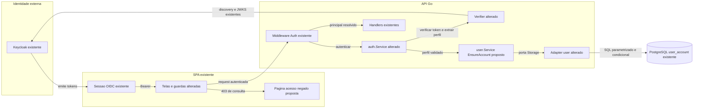
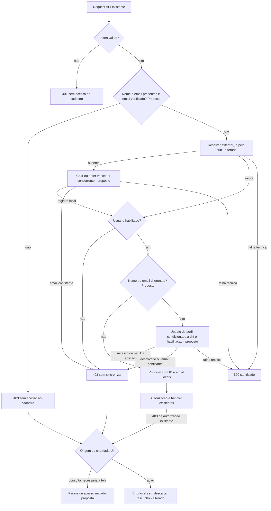
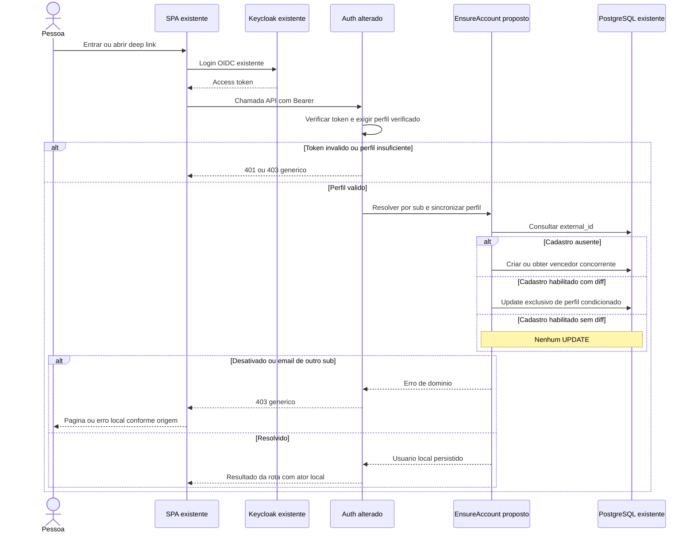

# ISSUE-3 — Cadastro automático e sincronização de perfil após login

## Objetivo

Cadastrar automaticamente em `user_account` quem ainda não possui vínculo local e sincronizar nome/e-mail pelo diff do access token validado do Keycloak, apresentando acesso negado na UI quando a API responder 403.

## Contexto e decisões

Origem: descrição fornecida pelo usuário nesta conversa, sem versão, links ou comentários externos informados. Refinamento em 2026-11-01. **Estado: implementação autorizada pelo usuário em 2026-11-02.**

### Fatos verificados

| Evidência | Comportamento atual |
|---|---|
| `api/internal/auth/service.go`, `Service.Authenticate` | Valida o token e chama `GetByExternalID(claims.UserID)`; inexistente e desativado recebem acesso negado. Não cadastra nem sincroniza. |
| `api/internal/auth/claims.go`, `Claims`; `api/internal/infra/keycloak/verifier.go`, `tokenClaims`/`Verifier.Verify` | `UserID` recebe `token.Subject`; perfil `name`, `email` e `email_verified` ainda não é extraído. |
| `api/internal/user/user.go`, `User`, `New`, `Sync` | Perfil local contém nome/e-mail; criação habilita o usuário; `Sync` sempre atualiza auditoria quando chamado. |
| `api/internal/user/storage.go`, `postgresStorage.Create`/`Update`/`toDomain` | INSERT simples; UPDATE também escreve estado de ativação; `updated_by` é omitido na persistência e lido incorretamente de `DisabledBy`. |
| `api/migrations/000001_create_users_table.up.sql`, `user_account` | `external_id` e `email` únicos, `name` e `email` obrigatórios, auditoria de criação/alteração e desativação. Schema já suporta a mudança. |
| `api/internal/audit/audit.go`, `Entry.Update`, `Actor` | Auditoria possui autor textual; identidade de negócio usa ID local numérico e e-mail. |
| `api/internal/infra/webserver/middleware/auth.go`, `Auth`/`reject` | 401/403/500 têm envelopes genéricos; autenticação tem timeout; logs usam motivos controlados sem erro bruto. |
| `infra/keycloak/guild-banker-clients.json`, client `guild-banker-ui`; `guild-banker-realm.json`, usuário Foo Bar | Scopes `basic`, `profile`, `email`, `roles`; usuário local de teste possui nome, e-mail e e-mail verificado. Isso é configuração, não prova de todos os claims emitidos em outro ambiente. |
| `api/internal/infra/keycloak/testdata/keycloak/README.md`, fixture `fixture-member`; `verifier_keycloak_integration_test.go`, `TestAuthKeycloakFixture` | Fixture antiga emitida com scopes reduzidos não contém perfil; hoje o teste HTTP aceita o token com lookup fictício. |
| `web/spa/src/app/session-provider.tsx`, `SessionProvider.request`; `shared/lib/query-client.ts`, `makeQueryClient` | 401 recupera login; 403 mantém a sessão e não tem retry automático. |
| `web/spa/src/app/app.tsx`, `AppRoutes`; `features/guilds/use-active-guild.ts`, `useActiveGuild`; `shared/components/header.tsx`, `Header` | Consulta de guilds é compartilhada, inclusive na Home; guarda atual usa `activeGuild` sem priorizar erro. |
| `web/spa/src/features/imports/api/use-imports.ts`, `useImports` | Upload/confirmação são mutations; revisão é estado de cache local, não GET remoto nesse fluxo. |

As specs ISSUE-1 (D6/CA10) e ISSUE-2 (D5) documentam o comportamento anterior e o follow-up. Esta issue substitui a exigência de cadastro prévio da ISSUE-1; preserva desativação local, ownership e membership. Não reescrever as evidências históricas dessas specs.

### Decisões confirmadas na entrevista

| ID | Origem | Decisão aprovada |
|---|---|---|
| D1 | Q1: “Confirmado” | Executar na primeira chamada autenticada à API após login e nas seguintes, usando apenas o access token validado. Sem endpoint novo nem consulta UserInfo/Admin. Mudanças no Keycloak dependem da emissão/renovação do token. |
| D2 | Q2: “É isso” | Diff apenas de `name` e `email`; gravar e atualizar auditoria somente se diferentes. Sem histórico separado. |
| D3 | Q3: “Pegue o ID do usuário no Keycloak e preencha … external_id e exija nome e e-mail” | `sub` do token validado é o ID Keycloak e preenche `external_id`; nome e e-mail obrigatórios. A alternativa de preservar claims ausentes foi descartada: exigir ambos também para usuários existentes. |
| D4 | Q4: “Confirmado” | E-mail de outro `sub` resulta em 403 genérico; não associar contas nem substituir vínculo. |
| D5 | Q5: “Sim, exigir” | Exigir `email_verified=true`. |
| D6 | Recorte UI, confirmado em “Sim, confirmado” | 403 de carregamento mostra página no conteúdo da rota com menu/Sair e link Home; 403 de ação permanece na tela com erro local. Mensagem genérica; Home disponível. |

### Critérios de aceite

Estes CAs formalizam o pedido e o refinamento; os detalhes técnicos complementares abaixo fazem parte da proposta submetida à aprovação final.

- **CA1 — Cadastro (pedido original, D1/D3):** token válido, perfil completo/verificado e `sub` sem cadastro criam exatamente um usuário habilitado, com ID local gerado e `external_id=sub`; a mesma chamada prossegue para autorização/handler. Seu resultado final continua sujeito às regras da rota; não se promete 200 para qualquer operação.
- **CA2 — Diff (pedido original, D2):** usuário ativo existente recebe somente as mudanças de nome/e-mail. Perfil igual não executa UPDATE nem modifica auditoria. Mudança isolada de nome ou e-mail e mudança conjunta são cobertas.
- **CA3 — Perfil obrigatório (D3/D5):** nome/e-mail ausentes, vazios ou só com espaços, e `email_verified` ausente/falso, negam acesso com 403, sem leitura/gravação de usuário nem fallback de username/given/family name. Aplica-se a cadastro novo e existente.
- **CA4 — Colisão (D4):** criação ou alteração para e-mail de outro `sub` resulta em 403 genérico e preserva integralmente os dois cadastros, inclusive nome/auditoria. Falha técnica não é confundida com conflito.
- **CA5 — Bloqueio local (preservação do contrato atual):** usuário desativado continua em 403 e não recebe atualização de perfil/reativação. Uma desativação concluída antes da gravação de perfil não é revertida nem recebe essa gravação.
- **CA6 — Concorrência (complementar de integridade):** primeiras chamadas concorrentes do mesmo `sub`/perfil convergem para um ID sem duplicata nem erro técnico causado apenas pela disputa. Sincronizações concorrentes para o mesmo perfil não geram updates redundantes; operações não reescrevem campos de desativação.
- **CA7 — Identidade e auditoria (D2/D3, complemento técnico):** ID/external_id e criação permanecem estáveis nas alterações; novo usuário usa e-mail validado em `created_by`; alteração usa e-mail recebido/verificado em `updated_by`. `updated_by` é persistido/lido corretamente. `Principal.Actor` usa ID e e-mail do resultado local persistido, inclusive na própria chamada que criou/alterou o usuário.
- **CA8 — Falhas e segurança (preservação e complemento):** token inválido/malformado recebe 401 sem acesso ao cadastro; indisponibilidade/cancelamento na persistência não liberam o handler e resultam no erro técnico sanitizado do fluxo (500). Sem tokens, perfil, e-mail, `sub`, SQL ou erro bruto em respostas/logs de autenticação. Contexto/timeout continuam propagados; 403 não inicia novo login.
- **CA9 — Página 403 (D6):** `/fixed-expenses`, `/transactions`, `/import` e `/guild` mostram acesso negado quando uma consulta necessária àquela tela falhar com 403. Erro tem prioridade sobre dados antigos em cache. Menu/Sair e link Home continuam operáveis; mensagem não infere a causa nem expõe o cadastro.
- **CA10 — Limite da guarda (D6):** 403 da lista de guilds bloqueia telas que dependem de guild, mas não impede Home nem despesas pessoais carregadas com sucesso. O seletor não expõe guilds antigas após esse erro; não há ciclo de redirects/retries. Outros erros mantêm seu tratamento atual; estado vazio de guilds não vira 403.
- **CA11 — Ações 403 (D6):** operações existentes de despesas, transações, convites/remoção e upload/confirmação mostram mensagem de permissão no feedback local já usado (inline/toast), sem navegação, logout ou replay. Preservam formulário/arquivo/revisão quando aplicável; não mostram sucesso nem limpam rascunho por uma resposta 403.

## Fora do escopo

Novos campos de perfil, histórico de diff, alteração manual de perfil, `/me`, rota `/403`, UserInfo/Admin API, webhook, job, cache de sincronização, controle de versão de perfil, múltiplos issuers, associação por e-mail, normalização de e-mail/case ou fusão de contas. Sem autoentrada em guild, mudança de permissões, sincronização de roles no banco ou reativação local. Sem alteração do schema, migração/seed de ambiente compartilhado, novas dependências, refatoração geral, tema Keycloak, deploy, commit ou implementação nesta etapa.

## Premissas e riscos

| # | Classificação / descrição | Evidência/motivo | Impacto e validação/mitigação |
|---|---|---|---|
| P1 | **Premissa:** token é snapshot, não versão monotônica do perfil. | D1; não existe versão de perfil em `user_account`. | Dois tokens ainda válidos de épocas diferentes podem reaplicar perfil antigo. Sem garantia de ordem por `iat`; registrar esse limite e comprovar aplicação do snapshot recebido. Controle de versão exige outro escopo. |
| P2 | **Premissa operacional:** emissor fornece `name`, `email`, `email_verified` no access token. | Clients locais têm scopes; fixture antiga não tem perfil. | Tokens antigos/incompletos deixam de autorizar a API. Conferir os claims de forma segura no ambiente de teste, sem imprimir token; renovar sessão após ajuste de mappers. |
| P3 | **Proposta técnica:** comparar strings como recebidas, sem lowercase/trim na persistência; whitespace-only é inválido. | D2/D3 e unicidade textual do schema existente. | Sem introduzir política de normalização. Testar alteração de capitalização como diff; sem ampliar para unicidade case-insensitive. |
| P4 | **Premissa operacional:** PostgreSQL 17+ isolado com permissão para schema de teste. | `infra/docker-compose.yml`, serviço `postgres` usa 17.9; driver `lib/pq` e sqlx em `api/go.mod`. | Presença do serviço não comprova credenciais/schema. Testes devem isolar dados e falhar claramente quando explicitamente solicitados sem DSN; nunca usar dados pessoais ou limpar tabelas compartilhadas. |
| P5 | **Proposta técnica:** corrigir `updated_by` somente no adapter de usuários tocado. | `userEntity`, `toDomain`, SQL atuais omitem/mapeiam incorretamente o campo existente no schema. | Necessário para CA7; testar round-trip com `updated_by` diferente de `disabled_by`. Não refatorar auditoria de outros módulos. |
| P6 | **Premissa:** autorização usa o estado observado na resolução local da chamada. | Fluxo síncrono atual; não há revogação de chamadas em voo. | Preservar desativação concorrente na escrita; não prometer cancelar uma operação já autorizada antes da desativação. |
| P7 | **Fato verificado:** configuração declara Go 1.27.3 e Node 24.6.0; nenhum build/teste foi executado neste planejamento. | `api/go.mod`, `.tool-versions`, `api/.tool-versions`; inspeção local de comandos. | Verificar toolchains na implementação. Presença de shim no PATH não prova runtime instalado. Mermaid: CLI `mmdc` não encontrada. |

Lacunas bloqueantes de comportamento: nenhuma após a entrevista. Premissas operacionais devem ser verificadas pelo executor antes dos gates que dependem delas.

## Arquitetura da solução

### Visão geral e contratos propostos

**Existente:** Gin/middleware → `auth.Service` → `user.Service` → `user.Storage`/PostgreSQL; verifier Keycloak separado da regra de cadastro. **Alterado:** extração de perfil e resolução da identidade local. **Proposto:** métodos estreitos de criação concorrente e atualização exclusiva de perfil, com erros de domínio distinguíveis. Nomes novos abaixo são propostas, não APIs já presentes.

1. **Adapter Keycloak:** estender `tokenClaims` e mapear para `auth.Claims{Name, Email, EmailVerified}`, sem tags de transporte no tipo interno. Continuar validando assinatura, issuer, audience, exp, `typ=Bearer` e `sub` antes de qualquer acesso ao usuário. String/bool com tipo JSON incompatível (inclusive `null` presente) é token malformado, 401. Ausência de claim pode ser extraída com zero value; a política de obrigatoriedade é da aplicação, 403.
2. **Aplicação auth:** depois de `Verify`, exigir nome/e-mail não brancos e verificação verdadeira, antes de chamar usuários. Substituir a porta `userLookup` por porta consumidora estreita para `EnsureAccount(ctx, externalID, name, email) (*user.User, error)` satisfeita por `*user.Service`. Não importar `auth` em `user`. Usar o `sub` intacto, nunca converter para inteiro nem aceitar headers como identidade. Formar `Principal` apenas após resolução bem sucedida e habilitada.
3. **Aplicação user:** adicionar `Service.EnsureAccount` com primitivas de perfil, sem JWT/Keycloak/HTTP. Validar entrada; buscar por external_id; se ausente, criar usando `user.New` e operação de criação tolerante à disputa pelo mesmo external_id; conferir ativação no registro efetivamente retornado; comparar nome/e-mail; chamar `User.Sync` e persistência de perfil apenas quando diferentes. Métodos Create/Update existentes não precisam ser renomeados nem redirecionados globalmente.
4. **Porta de persistência user:** estender `Storage` apenas com as operações necessárias, propostas `CreateIfAbsent(ctx, u) (*User, error)` e `UpdateProfile(ctx, u) (*User, error)`. `CreateIfAbsent` retorna o registro inserido ou o registro vencedor do mesmo external_id, nunca uma conta encontrada por e-mail. `UpdateProfile` retorna estado persistido atual, não apenas o objeto candidato. Ajustar mocks consumidores no mesmo commit.
5. **Atomicidade no adapter:** criação usa a unicidade de external_id, por exemplo INSERT com conflito específico de external_id seguido de leitura quando necessário; não engolir qualquer erro de unicidade. Update parametrizado escreve exclusivamente nome/e-mail e auditoria de alteração, condicionado a `enabled=true` e diff atual no banco. Condição de diff no banco evita escrita redundante quando dois serviços observaram o mesmo perfil antigo. Sem linha alterada, reler para distinguir desativação e perfil já aplicado; não fabricar sucesso com candidato não persistido. Não manter uma transação abortada após violação de unicidade. Não é necessário um lock de processo nem uma transação longa envolvendo validação JWT.
6. **Auditoria:** criação deixa `updated_at/by` nulos; diff muda ambos. Autor é o e-mail novo, autenticado/verificado, coerente com a convenção textual de `audit.Actor.Email`; não é log de PII. Nunca modificar id/external_id/criação ou ativação durante sync. Corrigir mapeamento `updated_by` em `userEntity`, SQL e conversões do adapter, inclusive leitura do registro vencedor.
7. **Erros:** propor sentinelas em `user/errors.go` para desativação e colisão de e-mail; classificar conflito pelo erro estruturado do driver, não texto. Auth converte para `ErrForbidden`/`RejectionError` com motivos controlados (perfil incompleto, e-mail não verificado, conflito, desativado); erro de IO continua técnico. Middleware mantém envelope genérico e um log sanitizado de rejeição. Não adicionar retry indiscriminado nem autenticar com cadastro parcialmente atualizado.
8. **UI:** componente compartilhado proposto `AccessDeniedPage`, renderizado na rota atual, sem redirect global. Consumidores de queries reconhecem `APIError.status===403`; guardas dão prioridade ao erro, inclusive em refetch com dados antigos. `useActiveGuild` deixa de fornecer guilds/seleção obsoletas em 403 e impede autoajuste da URL a partir delas; hooks dependentes não carregam recursos com esse estado. Home e despesas não são bloqueadas apenas por erro de guilds. Header mantém identidade/Sair e não mostra a lista recusada. Queries 403 continuam sem retry automático.
9. **Ações UI:** reaproveitar feedback local e i18n PT/EN, mensagem de permissão genérica. Manter separação de 401/403 em `SessionProvider`; não adicionar flag global de acesso negado. Nenhuma decisão de autorização é transferida à UI.

**Compatibilidade:** contrato HTTP de erro e contratos financeiros mantidos. A mudança intencional é: usuário ausente com perfil válido passa a ser criado; perfil incompleto/não verificado agora recebe 403. Atualizar documentação operacional/OpenAPI e regenerar tipos afetados. Fixture antiga continua original: verifier aceita assinatura válida, mas autenticação recusa seu perfil ausente; testar sucesso HTTP com tokens de perfil completos nas fixtures sintéticas existentes. A suíte real de login continua usando o Keycloak configurado, sem depender de seed prévio de usuário local.

### Diagrama arquitetural

### Fluxograma

### Jornada / sequência

Rastreabilidade dos diagramas: token/perfil → CA3/CA8; criação/diff → CA1/CA2/CA6/CA7; bloqueios → CA4/CA5; apresentação UI → CA9–CA11. **Sintaxe Mermaid não validada**: `mmdc` ausente; não foi instalada ferramenta neste planejamento.

## Arquivos impactados

Paths `[alterar]` foram verificados; `[criar]` são propostos em diretórios existentes. A lista detalhada de testes e critérios fica em cada task.

- [alterar] `api/internal/auth/{claims.go,service.go,errors.go}` e testes correspondentes — perfil e resolução local.
- [alterar] `api/internal/infra/keycloak/{verifier.go,verifier_test.go,verifier_http_integration_test.go,verifier_keycloak_integration_test.go}` — extração e integração HTTP.
- [alterar] `api/internal/user/{service.go,storage.go,errors.go,service_test.go,storage_test.go}` — caso de uso, operações atômicas, auditoria e mocks.
- [criar] `api/internal/user/storage_postgres_integration_test.go` — persistência/concorrência reais isoladas.
- [criar] `api/internal/infra/webserver/provisioning_integration_test.go` — composição auth/user/storage/middleware com PostgreSQL e verifier controlado.
- [alterar] `api/internal/infra/webserver/middleware/auth_integration_test.go` — status/logs das novas recusas; `auth.go` somente se necessário para mapeamento sanitizado.
- [alterar] `api/internal/infra/keycloak/testdata/keycloak/README.md`, `infra/keycloak/README.md`, `docs/specs/openapi.yaml` — novo contrato e fixture incompleta.
- [alterar] `web/spa/src/shared/api/schema.d.ts` — regeneração pelo script existente após OpenAPI.
- [criar] `web/spa/src/shared/components/access-denied-page.tsx` e `access-denied-page.test.tsx` — página compartilhada acessível.
- [alterar] `web/spa/src/app/{app.tsx,app.test.tsx,session-provider.test.tsx}`, `web/spa/src/shared/components/header.tsx` — guardas, isolamento e sessão preservada.
- [alterar] `web/spa/src/features/guilds/use-active-guild.ts`, `components/guild-selection-state.tsx` — estado de erro antes do cache.
- [alterar] consumidores de consultas/ações e testes nas features `fixed-expenses`, `transactions`, `guilds`, `imports`, especificados em T4/T5.
- [alterar] `web/spa/src/shared/lib/i18n.ts`, `web/spa/README.md`, `web/spa/e2e/navigation.spec.ts` — mensagens PT/EN, comportamento e jornada 403.
- [criar] `web/spa/src/features/transactions/components/transactions-page-client.test.tsx` — teste do consumidor de consulta/mutations ainda sem arquivo próprio.

`user.go`/`audit.go`, `cmd/server/main.go`, migrations, configuração do realm e `SessionProvider` de produção não precisam mudar: tipos/métodos e wiring existentes podem ser reutilizados. Se a implementação mostrar necessidade diferente, registrar justificativa antes de ampliar o escopo.

## Tasks

| Task | Título | Status | Depende de | Arquivo |
|---|---|---|---|---|
| T1 | Extrair claims de perfil validado | concluida | nenhuma | [T1](./ISSUE-3-T1-claims-perfil.md) |
| T2 | Resolver cadastro e diff com persistência segura | concluida | T1 | [T2](./ISSUE-3-T2-cadastro-diff.md) |
| T3 | Integrar cadastro ao fluxo de autenticação | ⬜ pendente | T2 | [T3](./ISSUE-3-T3-autenticacao-cadastro.md) |
| T4 | Exibir página de acesso negado em consultas | ⬜ pendente | T3 | [T4](./ISSUE-3-T4-pagina-acesso-negado.md) |
| T5 | Tratar permissão negada nas ações existentes | ⬜ pendente | T4 | [T5](./ISSUE-3-T5-acoes-acesso-negado.md) |

Cada task inclui seus testes e termina compilável, com os checks aplicáveis passando. T1/T2 introduzem capacidades sem conectá-las à autenticação; o comportamento passa a mudar em T3. Não há task genérica de testes finais.

## Verificação final

### Comandos confirmados e gates propostos

**Fatos:** Makefile confirma `api/vet`, `api/lint`, `api/build`, `api/test`, `api/test/integration`; alvo `check` ordena vet → lint → unitários da API e depois checks web. README da SPA e `package.json` confirmam o gate web abaixo. Não foi encontrado pipeline CI versionado a adotar; estes são gates locais. Build/integration complementam `check`, não são dependências dele.

1. Na raiz, Go compatível com `api/go.mod`, dependências disponíveis e compilador C para race: `make api/vet`, `make api/lint`, `make api/build`, `make api/test`, `make api/test/integration`. Esperado: checks e suítes existentes sem nova falha; fixture antiga com expectativa de perfil incompleto atualizada em T3.
2. **Novo gate proposto em T2/T3**, derivado do `go test` usado no Makefile: em `api/`, `go test ./... -race -count=1 -tags=integration,postgres`. Os novos testes usarão `//go:build integration && postgres` e variável de teste **proposta** `USER_TEST_DATABASE_URL`. Essa variável não existe hoje e não é configuração runtime. Deve apontar para PostgreSQL de teste, fornecida por ambiente, sem credenciais em argumentos/saída. Ausente/inválida → falha explícita; não skip. O gate padrão sem `postgres` conserva execução offline.
3. Testes PostgreSQL criam um schema exclusivo por suíte, configuram o search_path de todas as conexões e aplicam ali o SQL existente de criação (`api/migrations/000001_create_users_table.up.sql`). Limpam apenas o schema que criaram. Não iniciar o servidor real para preparar teste: `main` executa migrations. Sem DROP/TRUNCATE de tabelas/realms compartilhados. Gate é impedido enquanto não houver ambiente isolado adequado; não declarar CA4–CA6 provados apenas por mocks.
4. Na raiz, Node compatível (versão declarada 24.6.0), dependências instaladas por `npm --prefix web/spa ci`, Chromium disponível e portas de teste livres: `npm --prefix web/spa run api:types:check` → `npm --prefix web/spa run lint` → `npm --prefix web/spa run build` → `npm --prefix web/spa test` → `npm --prefix web/spa run test:e2e` → `npm --prefix web/spa run test:e2e:prod`. Fornecer configuração pública OIDC ao build conforme README, para o smoke compilado; nunca credenciais `VITE_*`.
5. Integração operacional existente: `npm --prefix web/spa run test:e2e:auth`, na raiz. Requer Keycloak local configurado, API compatível e Vite 5173 livre; credenciais fictícias por ambiente como definido em `playwright.auth.config.ts`. Não exige cadastro local prévio após T3. Não altera realm nem prepara banco compartilhado. Prova login/Bearer reais; criação/diff são provados separadamente pela integração PostgreSQL. Sem screenshots/trace/vídeo de autenticação.

Testes planejados listados nas tasks não são resultados observados. Gate de migração não aplicável: schema não muda. Instalação de dependências novas não aplicável. Publicação não aplicável.

### Matriz CA → task → evidência esperada

| CA | Tasks | Evidência esperada |
|---|---|---|
| CA1 | T2, T3 | Serviço + PostgreSQL + middleware: usuário ausente criado, mesmo ID no principal e uma linha por sub. |
| CA2 | T2, T3 | Unitários sem chamada de update em igualdade; teste real de linha/auditoria sem alteração; alterações isoladas/conjuntas aplicadas. |
| CA3 | T1, T3 | Decodificação tipada e tabela de perfil insuficiente; 403 antes de chamar serviço de usuários. |
| CA4 | T2, T3 | UNIQUE real em criação/update, erro de domínio e 403 HTTP; dois registros intactos. |
| CA5 | T2, T3 | Desativado e corrida controlada desativar/sync não alteram perfil/estado, com 403. |
| CA6 | T2 | Concorrência real com conexões independentes; mesmo ID, sem duplicatas e sem update redundante. |
| CA7 | T2, T3 | Round-trip de auditoria e principal com ID local/e-mail persistido após criação/update. |
| CA8 | T1, T3, T4 | Regressão criptográfica, zero chamadas em token inválido, timeout/500 sanitizado, motivos sem PII e 403 sem novo login. |
| CA9 | T4 | Queries 403 por rota e refetch com cache anterior; página sem dados financeiros, menu/Sair/Home operáveis. |
| CA10 | T4 | 403 guilds bloqueia rotas dependentes; Home/despesas seguem quando independentes; seletor sem lista antiga, sem loop. |
| CA11 | T5 | Cada família de mutation apresenta erro local; formulário/arquivo/revisão preservados, sem sucesso/logout/replay. |

### Revisão do planejamento

- **Requisitos:** CA1–CA11 cobertos; UI incluída por confirmação expressa; nenhuma inclusão automática em guild ou associação de contas.
- **Engenharia:** caminhos existentes conferidos; novas APIs/arquivos marcados como proposta; portas consumidoras sem ciclo user → auth; constraints e updates condicionais protegem integridade sem infraestrutura adicional.
- **Qualidade:** cinco tasks, dependências apenas anteriores, testes em cada uma, gate PostgreSQL explícito e separado do offline; comandos futuros não apresentados como resultados.
- **Convenções:** seguir `AGENTS.md` e `docs/go/{architecture,coding,naming}.md`; sem DTO/SQL em domínio, sem globais mutáveis, context nas fronteiras, testify nos testes Go, i18n na UI e logs sem PII. `.standards/go` referida no AGENTS não existe neste checkout; documentos confirmados estão em `docs/go`.

## Decisões

- **Decisão aprovada, 2026-11-02:** usuário solicitou implementar ISSUE-3 com dev-mage e qualidade de produção. Isso autoriza execução desta spec e seus commits locais; sem push/PR.
- **Fato verificado:** árvore inicial limpa; Go 1.27.3 e Node 24.6.0 disponíveis. Baseline auth/Keycloak passou.
- **Checkpoint:** T1 implementada com AC1/AC2 provados e revisão independente sem achados; AC3 bloqueado por lint incompatível com export data de Go 1.27.3. Vet/build/unitários race/integração race passaram. Ver detalhes na T1. T2–T5 não iniciadas, respeitando dependências.
- **Ambiente:** criado container isolado `guild-banker-issue3-test` (PostgreSQL 17.9, loopback 55433) para futura validação, sem alterar banco/realm do projeto. Nenhum teste PostgreSQL executado ainda.
- **Decisão aprovada, 2026-11-02:** usuário autorizou “Sim, ajustar o tooling”. Atualizar golangci-lint para versão compatível com Go 1.27.3 e dependências transitivas necessárias; manter gates obrigatórios. Changelog oficial: https://golangci-lint.run/docs/product/changelog/ (suporte Go 1.27 introduzido em v2.13; v2.15.0 publicada em 2026-10-16). Validação da atualização em andamento.

Checkpoint atualizado: bloqueio T1 resolvido por atualização autorizada do linter; todos os gates API passaram, lint 0 issues. T1 concluída.

Checkpoint T2: concluída com testes PostgreSQL reais de constraints/concorrência/desativação, revisão independente e todos os gates API aprovados. T1 commit `3a9b07e`.
