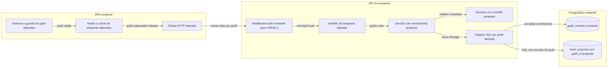
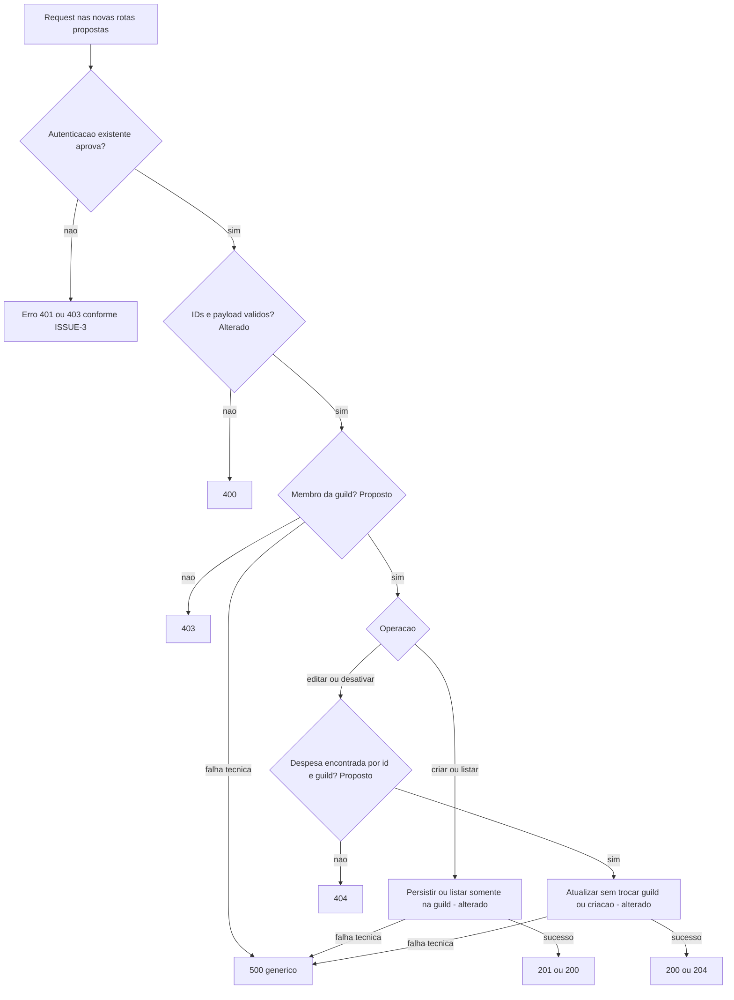
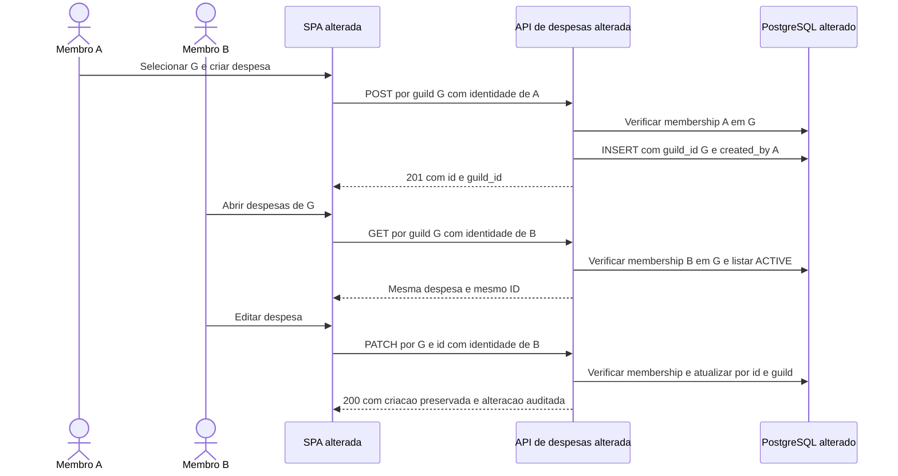

# ISSUE-4 — Despesas fixas compartilhadas por guild

## Objetivo

Vincular cada despesa fixa a uma única guild, permitindo que todos os seus membros criem, visualizem, editem e desativem essas despesas, com isolamento entre guilds e autoria preservada na auditoria.

## Contexto e decisões

Origem: demanda fornecida pelo usuário nesta conversa, identificada por ele como **ISSUE-4**. Refinamento em 2026-11-02, sem links, versão ou comentários externos informados. **Estado: spec aprovada pelo usuário em 2026-11-02; implementação não iniciada.** Aprovação explícita nesta conversa: “aprovada”. A aprovação valida o plano; não autoriza iniciar a implementação.

### Fatos verificados

| Evidência: caminho e símbolo | Comportamento atual |
|---|---|
| `api/internal/fixed_expense/fixed_expense.go`, `FixedExpense`/`New` | A entidade não contém `GuildID` nem `UserID`; contém valor, vencimento, categoria, status e auditoria. |
| `api/migrations/000001_create_users_table.up.sql`, tabela `fixed_expense` e índice `idx_fixed_expense_user_id_status` | `user_id` obrigatório referencia `user_account`; não há `guild_id`. |
| `api/internal/fixed_expense/storage.go`, `Create`/`GetByIDAndUser`/`ListActiveByUser`/`Update` | Criação e filtros usam o ID do usuário; leitura e alteração são pessoais. A listagem traz somente ACTIVE, ordenada por vencimento e nome. |
| `api/internal/fixed_expense/service.go`, `Storage`/`Service`; `handler.go`, `getRequesterActor`/`getRequesterUserID` | A aplicação recebe identidade local autenticada e não verifica membership de guild para despesas. |
| `api/internal/infra/webserver/routes.go`, `registerRoutes` | Rotas de despesas não incluem guild; transações e importações incluem `guildID`. |
| `api/internal/transaction/service.go`, `authorizeGuildMember`; `storage.go`, `IsGuildMember` | Há padrão de autorização na aplicação com consulta parametrizada a `guild_member`, sem importar serviço de guild no domínio de transações. |
| `api/internal/fixed_expense/dto.go`, DTOs e `toResponse`; `docs/specs/openapi.yaml`, `FixedExpenseResponse` | Resposta sem identificação da guild; nome não é editável pelo PATCH; dinheiro é serializado como string decimal. |
| `api/database/migrations.go`, `Migrate`; `api/cmd/server/main.go`, `main` | Startup executa migrations pendentes. Alterar o conteúdo da migration inicial não reaplica uma versão já executada. |
| `web/spa/src/app/app.tsx`, `AppRoutes.guildPage`; `features/guilds/use-active-guild.ts`, `useActiveGuild` | Já existe seleção por `?guild=` e remontagem por ID nas páginas dependentes; despesas usam apenas a guarda de sessão. |
| `web/spa/src/features/fixed-expenses/api/use-fixed-expenses.ts`, `fixedExpenseKeys`/`useExpenseMutation`; `fixed-expenses.api.ts`, `fixedExpensesApi` | Cache por usuário, sem guild; cliente chama `/api/v1/fixed-expenses`. |
| `web/spa/src/features/fixed-expenses/components/fixed-expenses-page-client.tsx`, `FixedExpensesPageClient`; `fixed-expense-modal.tsx`, `onSubmit` | Modais, confirmação, formulário e foco são estados locais; mutations não capturam guild nas variáveis. |
| `web/spa/src/mocks/handlers/fixed-expenses.ts`, `expensesByUser`; `mocks/request-context.ts`, `mockGuildMember` | Mock mantém despesas por usuário; já existe membership demonstrativa com usuários 1 e 2 compartilhando a guild 2. |
| `web/spa/src/shared/lib/i18n.ts`, `fx.title`/`fx.badge`/`fx.info`; `web/spa/README.md`, “Modos, estado e contrato” | Interface/documentação descrevem despesas como pessoais, fora do total da guild. |
| `web/spa/e2e/auth.spec.ts`, teste `real API authorizes the linked identity` | Login real hoje exige 200 da rota pessoal e título pessoal. Não exige membership para essa consulta. |

### Decisões confirmadas na entrevista

| ID | Origem | Decisão aprovada |
|---|---|---|
| D1 | Pedido original + Q1: “todos os membros podem criar, editar e desativar” | Toda despesa pertence a uma guild; qualquer membro pode realizar as quatro operações. Sem restrição de escrita ao criador. |
| D2 | Q2: “Não há dados a preservar” | Pode ajustar o schema inicial. Sem backfill, mapeamento usuário → guild ou preservação de despesas antigas. Isso não autoriza apagar um banco/volume compartilhado. |
| D3 | Q3: “Sim” à substituição conjunta | Substituir as rotas pessoais por `/api/v1/guilds/{guildID}/fixed-expenses`, incluindo os sufixos de edição/desativação; atualizar API, SPA, OpenAPI, mocks e testes juntos. Não manter aliases antigos. |
| D4 | Q4: “Sim” ao pré-requisito | Implementar após a ISSUE-3 completa, incluindo página de acesso negado e erros locais de ações. Adaptar esse comportamento à dependência de guild. |

**Contradição resolvida por D1/D4:** a [ISSUE-3](./ISSUE-3-cadastro-sincronizacao-usuarios.md), CA10/T4, preserva despesas pessoais independentes da consulta de guilds. Essa regra vale até a ISSUE-4. A partir de T1 desta spec, `/fixed-expenses` depende de guild e recebe a mesma guarda das outras páginas dependentes. Home continua independente. Não reescrever specs anteriores como se já previssem a mudança.

### Critérios de aceite

CA1–CA3 formalizam o pedido e D1; CA4–CA11 detalham tecnicamente a solução aprovada com esta spec.

- **CA1 — Vínculo:** toda nova despesa tem `GuildID` positivo, persistido em `guild_id NOT NULL REFERENCES guild(id)` e devolvido como `guild_id`. Não há despesa pessoal/global, seleção automática de todas as guilds do criador nem mudança de guild pelo PATCH.
- **CA2 — Compartilhamento:** membro A cria na guild G; membro B da mesma guild consulta a mesma despesa, com o mesmo ID, e pode editar/desativar. A listagem continua apenas ACTIVE, ordenada por `due_day`, depois `name`; lista vazia retorna `[]`.
- **CA3 — Autorização e isolamento:** criar/listar/editar/desativar exigem membership de G no backend. Não membro recebe 403. Membro de G tentando alterar ID de outra guild recebe 404 sem ler/alterar o recurso alheio, inclusive se também for membro da outra guild. Usuário removido perde autorização nas chamadas seguintes.
- **CA4 — Contrato:** somente as quatro operações sob as novas rotas ficam registradas. Requisição autenticada às rotas antigas retorna 404; requisição sem token continua sujeita ao middleware 401 do prefixo `/api`. IDs inválidos recebem 400; códigos de sucesso são 201/200/200/204. OpenAPI, tipos gerados e clientes refletem o mesmo contrato.
- **CA5 — Identidade e auditoria:** identidade vem do principal autenticado, nunca de headers/body enviados pelo cliente. `created_by/at` permanecem na alteração; `updated_by/at` registram o membro que alterou ou desativou. Não usar autor textual como owner nem filtrar pelo criador. Remover membership do criador não remove a despesa.
- **CA6 — Guarda da interface:** sem sessão ou guild válida, não consultar despesas nem enviar mutations. Lista de guilds vazia/seleção inválida mantém o estado existente; 403 da consulta de guilds ou despesas exibe a página genérica da ISSUE-3, antes de dados antigos. Home/menu/Sair continuam operáveis; 403 de ação permanece local e preserva rascunho.
- **CA7 — Contexto e respostas tardias:** cache inclui usuário e guild. Troca de guild não apresenta dados da guild anterior e fecha modal/confirmação antigos. Mutation captura guild de origem; sua conclusão não altera/invalida lista, formulário ou feedback de outra guild. Logout/troca de usuário preservam cancelamento e limpeza de cache existentes.
- **CA8 — Persistência:** schema inicial troca `user_id` por `guild_id` e índice por `(guild_id, status)`. SELECT/UPDATE por despesa incluem ID e guild no predicado; INSERT usa a guild autorizada. FK, round-trip de guild/auditoria e isolamento são comprovados com PostgreSQL real isolado, além de mocks.
- **CA9 — Sem regressão financeira:** preservar dinheiro decimal, validações de valor/vencimento/categoria, nome somente leitura na edição e desativação PAUSED/CANCELLED. Sem campo de visibilidade, geração de transações ou alteração de totais. Textos PT/EN descrevem despesas compartilhadas pela guild.
- **CA10 — Falhas:** erro técnico ao consultar membership não autoriza a operação. Validação recebe 400, não membro 403, recurso ausente no escopo 404 e erro técnico inesperado 500 genérico, sem SQL/credenciais/dados financeiros na resposta. Propagar contexto da requisição; não repetir mutations automaticamente.
- **CA11 — Demonstração e integração:** mocks compartilham por guild e respeitam membership; testes distinguem dois membros da mesma guild de usuários/guilds sem acesso. Fluxos existentes de CRUD/foco, navegação, sessão e login real são adaptados sem declarar mocks como prova da autorização real.

## Fora do escopo

Despesas privadas, roles/admin da guild, restrições por criador, transferência de despesa entre guilds, alteração das regras de habilitação da guild, renomeação pelo PATCH, listagem de pausadas/canceladas, cálculo de totais, rateio, recorrência executável, vínculo com transações/importação, notificações em tempo real/polling e histórico adicional de auditoria. Sem novas bibliotecas, novos serviços, refatoração de outros módulos, alteração de IAM, deploy ou preservação/migração de dados antigos. Nesta etapa, somente estes documentos são escritos; sem código, execução de migrations, commit ou push.

## Premissas e riscos

| ID | Classificação e descrição | Base | Impacto e mitigação |
|---|---|---|---|
| P1 | **Premissa operacional:** ISSUE-3 concluída antes da execução. | D4; seus arquivos estão pendentes no checkout investigado. | Revalidar caminhos e comportamento após sua implementação. Reutilizar a página 403 e o feedback local; não duplicá-los. Se o pré-requisito não estiver concluído, não iniciar T1. |
| P2 | **Informação confirmada:** não há dados a preservar. **Proposta:** ajustar apenas a migration inicial. | D2; existe somente a migration `000001` no checkout. | Banco que já executou versão 1 não é atualizado pela edição. Validar em banco/schema novo e isolado; registrar pré-requisito de ambiente novo para execução real. Não executar `infra/clean`, force/down ou limpeza compartilhada. |
| P3 | **Premissa operacional:** PostgreSQL 17+ de testes, com credenciais e permissão para criar schema exclusivo. | `infra/docker-compose.yml`, serviço `postgres:17.9`; `api/database/db.go`, sqlx/libpq. | Serviço disponível não prova schema/credenciais. Gate PostgreSQL explícito falha se não configurado; limpar apenas schema criado pelo próprio teste. Não usar startup da API para preparar um banco desconhecido. |
| P4 | **Premissa:** compartilhar significa consultar os mesmos registros, sem atualização instantânea entre sessões. | Pedido/D1; `useFixedExpenses` hoje usa cache e não há assinatura de eventos nessa feature. | Outra sessão vê mudanças ao executar nova consulta/refetch. Testar consulta posterior; não prometer sincronização ao vivo nem adicionar polling. |
| P5 | **Proposta técnica:** autorização observa membership na chamada; sem revogação de requests já autorizadas em voo. | Padrão existente `transaction.Service.authorizeGuildMember`. | Remoção concluída antes da próxima chamada deve negar acesso. Não introduzir locking distribuído ou serialização com remoção de membros. |
| P6 | **Premissa de escopo:** totais e transações mantêm comportamento atual. | Pedido trata visibilidade/acesso; textos atuais distinguem cadastro de despesa e total. | Corrigir explicação na UI sem passar a somar duas vezes ou gerar lançamentos. |
| P7 | **Fato verificado:** Go 1.27.3 e Node 24.6.0 declarados; nenhum teste/build de aplicação executado neste planejamento. | `api/go.mod`, `.tool-versions`, `api/.tool-versions`; inspeção de comandos. | Executor confirma runtime/dependências antes dos gates. Nenhum resultado futuro abaixo é evidência obtida. |

Lacunas bloqueantes de negócio: nenhuma após Q1–Q4. Ambiente de teste e implementação da ISSUE-3 são pré-requisitos operacionais, não fatos de disponibilidade confirmados.

## Arquitetura da solução

### Visão geral

**Existente:** SPA → Gin/Auth → `fixedexpense.Service` → porta `Storage` → PostgreSQL. **Alterados:** seleção/cache da SPA, contrato HTTP, entidade, serviço, adapter, schema inicial e mocks. **Propostos:** métodos por guild e classificação de erros necessários ao novo contrato. Nenhuma nova camada/serviço ou dependência de `fixedexpense` no serviço de guild.

1. **Domínio e banco:** adicionar `GuildID int64` ao domínio e validar valor positivo em `New`/`Validate`, sem tags SQL/JSON. Preservar campos e métodos financeiros. Trocar `user_id` por `guild_id` obrigatório no schema inicial e criar `idx_fixed_expense_guild_id_status`. Usar FK para `guild(id)` com comportamento padrão de restrição, como as FKs de guild em `transaction`/`import_batch`; não introduzir delete de guild nesta demanda. Não manter owner numérico: auditoria existente registra autoria, membership autoriza.
2. **Porta consumidora/aplicação:** substituir métodos pessoais por propostas `IsGuildMember(ctx, guildID, userID)`, `Create(ctx, expense)`, `GetByIDAndGuild(ctx, id, guildID)`, `ListActiveByGuild(ctx, guildID)` e `Update(ctx, expense)`. A aplicação recebe guild e ator em cada operação, valida identidade/IDs e membership antes do acesso às despesas. Aplicar o padrão de transações sem copiar suas regras de PRIVATE/PUBLIC. Novo erro de domínio de não membro; classificação mínima de validação para distingui-la de falhas técnicas, sem refatorar erros de outros módulos.
3. **Adapter:** consultar `guild_member` com ID local autenticado e guild. INSERT persiste `expense.GuildID`; SELECT por ID e UPDATE filtram `id` **e** `guild_id`; listagem filtra guild e ACTIVE. Mapeamentos entity ↔ domínio preservam guild e auditoria. UPDATE não modifica `guild_id` nem criação. Nenhuma linha no escopo significa `ErrFixedExpenseNotFound`; falha de IO é encapsulada com `%w`, não convertida em “não membro”.
4. **Transporte:** parsear `guildID` positivo da URL e obter ator do principal em todos os handlers, inclusive listagem. Remover acesso pessoal e o extrator de usuário que se tornar órfão exclusivamente neste módulo. Fonte da guild é a URL; bodies não selecionam guild/owner e não podem transferir o registro. Usar DTO para expor `guild_id`. Manter envelope simples `{"error":"..."}` e sanitizar falhas técnicas; validação de dados continua 400.
5. **SPA:** reutilizar a guarda de guild da ISSUE-3 em `/fixed-expenses`, mantendo essa URL de tela e `?guild=`. Keys propostas `['fixed-expenses', userID, guildID]`. Query só habilita com sessão/guild válida e mantém `AbortSignal`. Create/update/deactivate capturam `guildId` nas variáveis; sucesso invalida a chave da origem. Remontagem por ID fecha formulário/confirmação; respostas antigas não produzem efeitos na nova tela. Preservar 401/403, sem estado global de acesso negado nem atualização financeira otimista.
6. **Mocks e textos:** usar coleção por guild, checar `mockGuildMember`, localizar ID dentro dessa coleção e compartilhar registros entre membros. Fixtures distinguem G1 e G2; headers de identidade continuam exclusivos da demo. Textos propostos: “Despesas fixas da guild” / “Guild fixed expenses”, badge de compartilhamento e explicação de acesso por membros, sem anunciar alteração de total. Ajustar nomes acessíveis e seus testes.
7. **Compatibilidade:** a quebra aprovada D3 é feita em uma única task de troca (T2), junto com cliente/mocks/contrato. T1 prepara somente guarda/cache/contexto, mantendo o HTTP pessoal existente e seus textos até T2; não anuncia compartilhamento antecipado. Não criar aliases, feature flags ou duas implementações persistentes. API e SPA de T2 devem ser usadas juntas com schema novo.

### Contrato HTTP proposto

| Método | Rota | Entrada | Sucesso |
|---|---|---|---|
| POST | `/api/v1/guilds/{guildID}/fixed-expenses` | `name`, `amount`, `due_day`, `category` existentes | 201, despesa com `guild_id` |
| GET | `/api/v1/guilds/{guildID}/fixed-expenses` | Guild da URL; sem owner no body/query | 200, array de despesas ACTIVE com `guild_id` |
| PATCH | `/api/v1/guilds/{guildID}/fixed-expenses/{id}` | `amount`, `due_day`, `category`, `status` opcionais existentes | 200, despesa com `guild_id` |
| PATCH | `/api/v1/guilds/{guildID}/fixed-expenses/{id}/deactivate` | `status`: PAUSED ou CANCELLED | 204, sem corpo |

Todos exigem Bearer no modo real; 401/403/400/500 conforme CA4/CA10, com 404 adicional nas operações por ID. Guild sem vínculo de membership retorna 403, inclusive ID de guild inexistente, seguindo a verificação de membership existente. Recurso de outra guild é indistinguível de recurso inexistente dentro da guild autorizada. Não adicionar endpoint GET individual. Manter operationIds existentes e adicionar parâmetro de guild em cada operação; resposta `FixedExpenseResponse.guild_id` obrigatória. Campos monetários e enums permanecem os atuais.

### Diagrama arquitetural

### Fluxograma de autorização

O fluxograma resume autorização e falhas; validações de domínio adicionais mantêm 400. Não promete uma ordem entre JSON inválido e falta de membership além de nunca acessar despesas sem autorização.

### Jornada de compartilhamento

Rastreabilidade: membership/escopo → CA1–CA3/CA5/CA8/CA10; rotas → CA4; interface/cache → CA6/CA7/CA9/CA11. **Sintaxe Mermaid não validada**: `mmdc` não encontrada; nenhuma ferramenta instalada neste planejamento. Dúvidas arquiteturais bloqueantes: nenhuma; detalhes propostos aprovados com a spec, ainda não implementados.

## Arquivos impactados

Paths abaixo foram conferidos no checkout. Itens `[criar]` são propostos em diretórios existentes. Os arquivos produzidos pela ISSUE-3 devem ser reconferidos após sua implementação; não são tratados como existentes hoje.

- [alterar] `api/migrations/000001_create_users_table.up.sql` — vínculo/FK/índice; down existente já remove a tabela inteira e não precisa de nova operação.
- [alterar] `api/internal/fixed_expense/{fixed_expense.go,service.go,storage.go,handler.go,dto.go,errors.go}` — vínculo, autorização, consultas e contrato.
- [alterar] `api/internal/fixed_expense/{fixed_expense_test.go,service_test.go,handler_test.go}` — testes de domínio/aplicação/HTTP; handler test usa tag integration.
- [criar] `api/internal/fixed_expense/storage_postgres_integration_test.go` — persistência e isolamento reais com tag integration + postgres.
- [alterar] `api/internal/infra/webserver/routes.go`, `routes_integration_test.go` — novas rotas, proteção e ausência de aliases.
- [alterar] `docs/specs/openapi.yaml`, `web/spa/src/shared/api/schema.d.ts` — contrato e tipos regenerados.
- [alterar] `web/spa/src/app/{app.tsx,app.test.tsx,session-provider.test.tsx}` — guarda, cache, respostas tardias e regressões de sessão.
- [alterar] `web/spa/src/features/fixed-expenses/api/{fixed-expenses.api.ts,use-fixed-expenses.ts}` — cliente por guild e contexto das operações.
- [criar] `web/spa/src/features/fixed-expenses/api/use-fixed-expenses.test.tsx` — chaves, habilitação e invalidação da guild de origem.
- [alterar] `web/spa/src/features/fixed-expenses/components/{fixed-expense-modal.tsx,fixed-expenses-page-client.tsx,fixed-expenses-page-client.test.tsx}` — captura da origem, estados locais e testes do novo contrato.
- [alterar] `web/spa/src/mocks/fixtures/fixed-expenses.ts`, `web/spa/src/mocks/handlers/{fixed-expenses.ts,contracts.test.ts}` — dados por guild e casos de compartilhamento/negativa.
- [alterar] `web/spa/src/shared/lib/i18n.ts`, `web/spa/README.md` — textos PT/EN, novo contrato e pré-requisitos operacionais.
- [alterar] `web/spa/e2e/{fixed-expenses.spec.ts,fixed-expense-contract.spec.ts,guild-context.spec.ts,navigation.spec.ts,auth.spec.ts}` — CRUD, navegação e autenticação real com contexto de guild.

Não há necessidade prevista de alterar `guild`, `transaction`, `importer`, `SessionProvider` de produção, configuração Keycloak, Makefile ou dependências. Reutilizar `useActiveGuild`, guarda e página 403 resultantes da ISSUE-3; não reimplementá-los por conveniência.

## Tasks

Pré-requisito externo para todas: **ISSUE-3 concluída**, conforme D4. Todas as tasks desta spec permanecem pendentes.

| Task | Título | Status | Depende de | Arquivo |
|---|---|---|---|---|
| T1 | Preparar contexto de guild nas despesas da SPA | ⬜ pendente | nenhuma task interna; ISSUE-3 concluída | [T1](./ISSUE-4-T1-contexto-guild-spa.md) |
| T2 | Substituir despesas pessoais por despesas da guild | ⬜ pendente | T1 | [T2](./ISSUE-4-T2-despesas-compartilhadas.md) |

**Justificativa da decomposição:** T1 entrega guarda/reset/cache verificáveis sobre a API atual. T2 é um commit coeso de troca do vínculo, reunindo schema, todas as camadas da feature, cliente, mocks e contrato para não deixar consumidor apontando para rota removida. Cada task inclui seus testes e termina com gates aplicáveis passando; não há task genérica de testes finais nem código intencionalmente quebrado para a próxima. Não executar ou publicar metade de T2.

## Verificação final

### Comandos confirmados e gates propostos

**Fatos:** `Makefile` define `api/vet`, `api/lint`, `api/test`, `api/build`, `api/test/integration` e `check`; o último lista vet → lint → testes da API, depois lint/testes web. `web/spa/README.md` e `package.json` definem o gate web abaixo. Não foi encontrado pipeline CI versionado a seguir. Build, PostgreSQL e login real complementam os checks locais.

1. **API, na raiz:** `make api/vet` → `make api/lint` → `make api/test`; complementar com `make api/build` e `make api/test/integration`. Pré-requisitos: Go compatível com `api/go.mod`, ferramentas/dependências disponíveis e compilador C para race. O gate integration existente cobre HTTP com fixtures locais, não comprova sozinho PostgreSQL real.
2. **PostgreSQL, novo gate proposto de T2:** em `api/`, `go test ./internal/fixed_expense -race -count=1 -tags=integration,postgres`. Derivado do comando `go test` confirmado no Makefile; a combinação de tags e o teste são propostos. Nova variável exclusiva de teste `FIXED_EXPENSE_TEST_DATABASE_URL`, fornecida por ambiente, aponta para PostgreSQL de testes sem imprimir credenciais. Ausente/inválida quando solicitado → falha explícita, sem skip. Cada suíte cria schema exclusivo, configura search_path para todas as conexões, aplica ali o SQL inicial atualizado, insere fixtures fictícias e limpa somente seu próprio schema. Não executar migrations no banco da aplicação/Keycloak.
3. **Regressão PostgreSQL da ISSUE-3:** reexecutar o gate por ela definido, `go test ./... -race -count=1 -tags=integration,postgres`, em `api/`. Exige também `USER_TEST_DATABASE_URL` conforme a spec anterior, além da variável nova. Comprovar que seu teste de provisioning ainda funciona com o schema inicial atualizado. Essas variáveis são de teste; não alterar configuração runtime para acomodá-las.
4. **SPA, na raiz:** se necessário instalar as dependências já declaradas por `npm --prefix web/spa ci`; executar `npm --prefix web/spa run api:types:check` → `npm --prefix web/spa run lint` → `npm --prefix web/spa run build` → `npm --prefix web/spa test` → `npm --prefix web/spa run test:e2e` → `npm --prefix web/spa run test:e2e:prod`. Node 24.6.0/compatível, Chromium e portas livres. Build recebe configuração pública OIDC conforme README; tipos são regenerados em T2 por `npm --prefix web/spa run api:types`. Não editar arquivo gerado à mão.
5. **Login real, na raiz:** `npm --prefix web/spa run test:e2e:auth`. Requer Keycloak configurado, API de T2 em 8081 com schema novo, Vite 5173 livre e senha fictícia via ambiente conforme `playwright.auth.config.ts`. Adaptar `auth.spec.ts` para preparar, pelas rotas públicas existentes, uma guild de teste com o usuário autenticado caso ainda não exista no ambiente dedicado, selecionar seu ID e consultar a nova rota. Não escrever SQL no teste de navegador, não semear automaticamente ambiente compartilhado nem depender de ID fixo. Criar guild apenas no ambiente de teste acordado; não alterar realm. Sem trace/screenshot/vídeo de credenciais/tokens. Esse teste prova login/Bearer/consulta real; acesso por dois membros e isolamento real são provados na integração PostgreSQL/HTTP da feature, não apenas pela demo.

Disponibilidade de infraestrutura não foi testada nesta fase. Não declarar CA3/CA8 concluídos só com mocks se o gate PostgreSQL estiver impedido. Preparação destrutiva de banco/volume compartilhado e upgrade de banco antigo são **não aplicáveis**, por D2 e pelo uso de schema novo. Publicação é **não aplicável** ao planejamento. Verificação manual adicional é opcional: duas sessões de teste consultando a mesma guild após refetch; não substitui os testes automatizados.

### Matriz CA → task → evidência esperada

| CA | Tasks | Evidência esperada |
|---|---|---|
| CA1 | T2 | Domínio rejeita guild inválida; FK/NOT NULL reais e resposta com guild autorizada; PATCH não transfere registro. |
| CA2 | T2 | A cria, B consulta/edita/desativa a mesma linha; ordenação/ACTIVE/array vazio preservados. |
| CA3 | T2 | Tabela das quatro operações para membro/não membro/removido; ID de outra guild retorna 404, inclusive usuário membro de ambas, sem alteração real no banco. |
| CA4 | T2 | Registro de rotas + HTTP: sucessos, IDs inválidos, 401 e rotas antigas 404 autenticadas; geração de tipos sem drift. |
| CA5 | T2 | Headers conflitantes ignorados; round-trip de autoria/criação e alteração por B; remover criador da guild preserva linha. |
| CA6 | T1, T2 | Guarda não consulta sem guild; vazio/inválido/403 inicial/refetch; página/erro local da ISSUE-3 preservados. |
| CA7 | T1, T2 | Testes de hook/chaves, navegação/histórico, modais fechados e respostas tardias sem efeito em outra guild ou sessão. |
| CA8 | T2 | SQL real, FK, criação/consulta/update por guild e schema novo; testes da ISSUE-3 com migration revisada. |
| CA9 | T2 | Regressões de valor, nome read-only, status, foco, payloads e textos PT/EN; sem mudanças em totais/transações. |
| CA10 | T2 | Falha de membership sem chamada de despesa; erros 400/403/404/500 sanitizados, contexto propagado, mutation sem replay. |
| CA11 | T1, T2 | MSW por guild com dois membros, testes de sessão atualizados, E2E demo e login/Bearer real adaptados. |

### Revisão do planejamento

- **Requisitos:** decisões Q1–Q4 preservadas; CA1–CA11 cobertos, sem owner, visibilidade privada ou alteração de totais. Autorização e isolamento não ficam delegados ao cliente.
- **Engenharia:** duas tasks, dependências apenas anteriores e pré-requisito externo explícito. Troca de contrato integral em T2; T1 não anuncia compartilhamento. Novos símbolos/arquivos identificados como propostas; escopo financeiro permanece no módulo existente.
- **Qualidade:** testes próprios em cada task; distinção entre demo, HTTP controlado, PostgreSQL real e login real; comandos derivados de scripts conferidos e pré-requisitos explícitos. Resultados futuros não apresentados como observados.
- **Convenções:** seguir `AGENTS.md` e `docs/go/{architecture,coding,naming}.md`. Portas no consumidor, sem SQL/DTO no domínio, contexto nas fronteiras, erros com `%w` e `errors.Is/As`, testify nos testes Go, i18n na UI; sem pacotes utilitários ou globais novas de produção. Referências a `.standards/go` no AGENTS não têm diretório correspondente no checkout; documentos confirmados estão em `docs/go`.

## Decisões

<!-- Preenchido pelo dev-mage durante a implementação. Spec aprovada em 2026-11-02; tasks permanecem pendentes e a implementação requer autorização própria. -->
