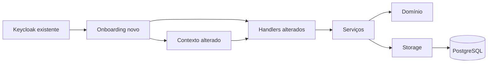
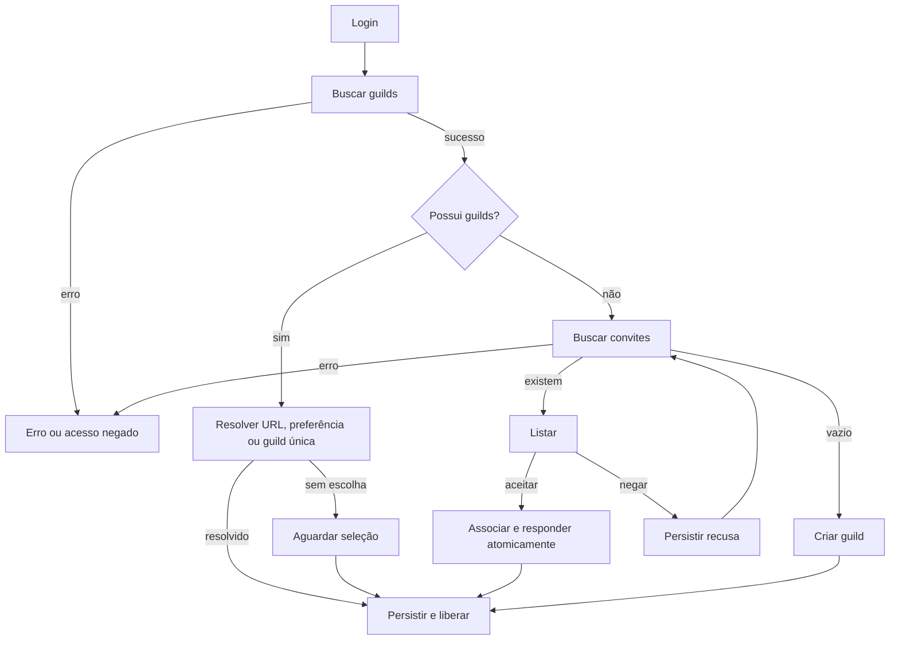
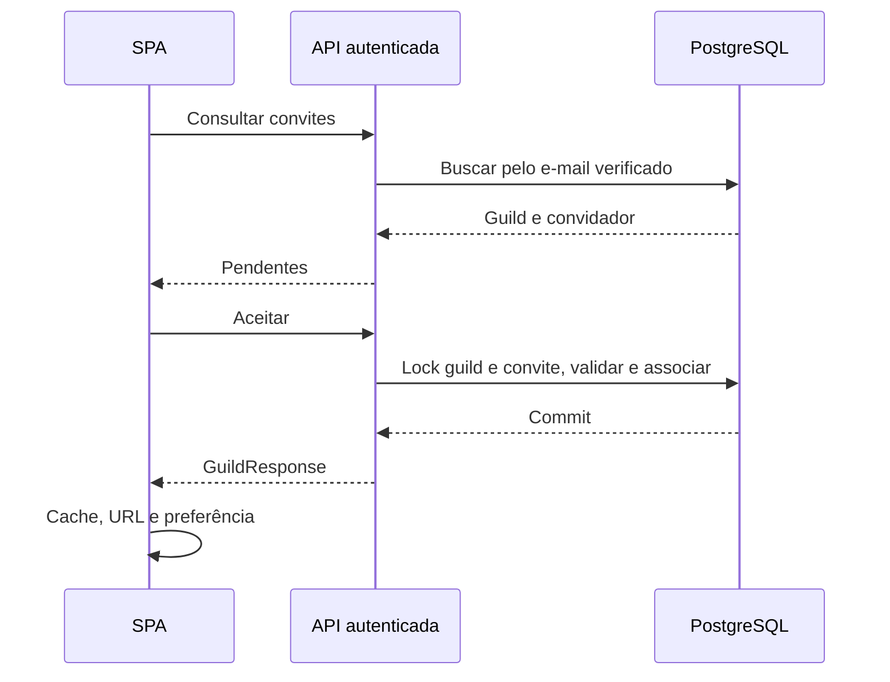

# ISSUE-5 — Onboarding de guild após login

## Objetivo e contexto
Origem: fornecida pelo usuário e aprovada nesta conversa em 2026-11-11.
Após autenticar, resolver uma guild antes de liberar Home, menu e telas financeiras.
Fatos verificados: useActiveGuild em web/spa/src/features/guilds/use-active-guild.ts seleciona a primeira guild sem persistência; AppRoutes em web/spa/src/app/app.tsx permite Home sem guild; Guild/DTOs em api/internal/guild não têm descrição; InviteByEmail em storage.go insere membership e consulta users em vez de user_account. auth.Service.Authenticate exige e-mail verificado e resolve a conta local.

## Critérios de aceite
- CA1: buscar guilds após autenticar e bloquear as telas até resolver contexto.
- CA2: URL válida precede preferência válida por usuário; guild única é automática; várias sem escolha válida exigem seleção. Persistir somente ID no localStorage e conservar após logout.
- CA3: sem guilds, listar pendentes do e-mail autenticado com dados da guild e nome/e-mail do convidador e Aceitar/Negar.
- CA4: aceite e membership atômicos; ativar guild aceita; outros convites continuam pendentes.
- CA5: recusa persistida sem membership; após confirmar lista vazia, apresentar criação.
- CA6: criar com display_name obrigatório até 70 caracteres e description opcional; associar criador e ativar contexto.
- CA7: name sempre gerado pela API: lowercase, sem acentos, espaços viram traços, somente [a-z0-9-], único e até 70 caracteres; sufixo em colisão; display_name pode repetir.
- CA8: updateGuildRequest recebe DisplayName/display_name e description; Name imutável, sem unicidade visual.
- CA9: convite para qualquer e-mail, mesmo antes do cadastro; sem expiração; duplicata pendente da mesma guild/e-mail e membro existente geram erros distintos. Reenvio após recusa permitido.
- CA10: loading/erro/403 não equivalem a vazio; preservar sessão, cancelamento, isolamento e proteção contra respostas tardias.

## Arquitetura e contratos aprovados
- Domínio puro; handlers → serviços → portas → storage PostgreSQL; contexto propagado. Sem novas abstrações genéricas.
- Description string no domínio, entidade e GuildResponse; migration 000002_add_guild_description up/down, coluna TEXT NOT NULL DEFAULT ''. Preservar migration inicial e memberships anteriores.
- CreateGuildRequest: display_name e description. Remover Name: campo adicional recebido nunca influencia geração.
- PUT /api/v1/guilds/{id}: display_name obrigatório e description opcional. Omissão preserva descrição, "" limpa. Remover NameExists para nome visual. Atualizar OpenAPI, tipos, mocks e OPENAPI_GAPS.
- DisplayName: trim nas extremidades, 1–70 runes; manter Unicode/acentos. Normalização de name na aplicação com x/text já existente, promovido a direto; domínio não importa dependência externa.
- Slug: NFD, remover marcas diacríticas, lowercase, whitespace → "-", filtrar ASCII, colapsar/trim traços. Base sem ASCII usa "guild". Colisão: hífen + 8 hex aleatórios, base truncada para total <=70. Até cinco novas tentativas após colisão inicial; repetir só constraint de nome, nunca outro erro. Esgotamento 503.
- Criar guild e membership do criador atomicamente, também em cada retry.
- Migration 000003_create_guild_invitation up/down: ID, guild, recipient_email normalizado, convidador, status PENDING|ACCEPTED|DECLINED, timestamps de criação/resposta. Unicidade parcial guild/e-mail WHERE PENDING; índice de pendentes por destinatário.
- POST /api/v1/guilds/{id}/invites continua 204, mas só cria pendência. Membro existente consultado por guild_member + user_account.
- GET /api/v1/guild-invites → array {id,guild:GuildResponse,invited_by:{name,email}} do e-mail do principal.
- POST /api/v1/guild-invites/{id}/accept → 200 GuildResponse após commit.
- POST /api/v1/guild-invites/{id}/decline → 204 após commit.
- Recurso alheio 404; já respondido 409. Identidade nunca vem de body/header alternativo.
- Emissão e aceite bloqueiam guild; respostas bloqueiam também convite, sempre guild → convite. Primeira resposta vence; rollback mantém convite pendente se membership falha.
- ErrorResponse mantém error e ganha code opcional: invitation_already_pending, guild_member_already_set, invitation_already_answered. APIError expõe code opcional; i18n para mensagens específicas.
- Contexto central abaixo de SessionProvider, interface useActiveGuild preservada. Preferência só validada pela listagem atual, chave por identidade separando demo/OIDC. Storage bloqueado/corrompido não impede uso.
- URL inválida exige seleção explícita, sem fallback silencioso; manter rota/query/histórico. Automático replace; escolha manual preserva histórico.
- Onboarding mostra cabeçalho com identidade/idioma/Sair, ocultando menu/conteúdo antes do contexto. 403 sem redirecionamento em loop.
- Consultar convites somente após guilds concluírem vazias. Após recusa reconsultar antes de mostrar criação. Aceite/criação atualizam cache com resposta autorizada e ativam guild, sem aguardar outro GET.
- Sem retry automático de mutations; desabilitar ações pendentes; efeitos tardios após logout ignorados. Mocks com memberships/convites mutáveis e reset por teste.

## Diagramas

Sintaxe Mermaid não validada no planejamento: parser requereu DOM indisponível.

## Fora do escopo e premissas
Sem envio de e-mails, expiração, revogação, inbox para membros, owner/roles, alteração IAM ou nova tela de edição. Preservar regras de enabled existentes e dados legados, sem constraints retroativas que invalidem nomes antigos.
Premissas aprovadas com o plano: fallback técnico "guild" sem ASCII; descrição omitida preserva; URL inválida pede seleção.
Infraestrutura de teste deve ser exclusiva; não executar down/force ou apagar dados compartilhados.

## Tasks
| Task | Título | Status | Depende de | Arquivo |
|---|---|---|---|---|
| T1 | Metadados e nome de guild | concluida | nenhuma | [T1](./ISSUE-5-T1-metadados-guild.md) |
| T2 | Emissão de convites pendentes | pendente | T1 | [T2](./ISSUE-5-T2-emissao-convites.md) |
| T3 | Consulta e resposta de convites | pendente | T2 | [T3](./ISSUE-5-T3-resposta-convites.md) |
| T4 | Contexto e preferência | pendente | T1 | [T4](./ISSUE-5-T4-preferencia-guild.md) |
| T5 | Componentes de onboarding | pendente | T3,T4 | [T5](./ISSUE-5-T5-telas-onboarding.md) |
| T6 | Entrada obrigatória | pendente | T5 | [T6](./ISSUE-5-T6-entrada-obrigatoria.md) |

## Verificação final
API raiz: make api/vet api/lint api/test api/test/integration api/build.
PostgreSQL em api/: go test ./... -race -count=1 -tags=integration,postgres; URLs USER_TEST_DATABASE_URL, FIXED_EXPENSE_TEST_DATABASE_URL, GUILD_TEST_DATABASE_URL exclusivas.
Frontend raiz: npm --prefix web/spa run api:types:check → lint → build → test → test:e2e → test:e2e:prod → test:e2e:auth (cada nome via npm run; test via npm test).
Build exige VITE_KEYCLOAK_URL/REALM/CLIENT_ID. E2E real requer API/Keycloak e credenciais por ambiente; criação só no ambiente exclusivo.
| CA | Tasks | Evidência esperada |
|---|---|---|
| CA1–2 | T4–6 | contexto/preferência/links/entrada |
| CA3 | T3,T5–6 | contrato e cartões |
| CA4–5 | T3,T5–6 | transações e jornadas |
| CA6–7 | T1,T5–6 | limites/slug/criação |
| CA8 | T1 | update e imutabilidade |
| CA9 | T2–3,T5 | concorrência e feedback |
| CA10 | T3–6 | isolamento/autorização/rollback/erros |

## Decisões e checkpoint
Implementação autorizada pelo usuário: "Implement the plan."
Working tree inicial limpo; branch feat/issue-5-guild-onboarding.
Go 1.27.3 agora disponível. Baseline/testes e evidências serão registrados por task.

