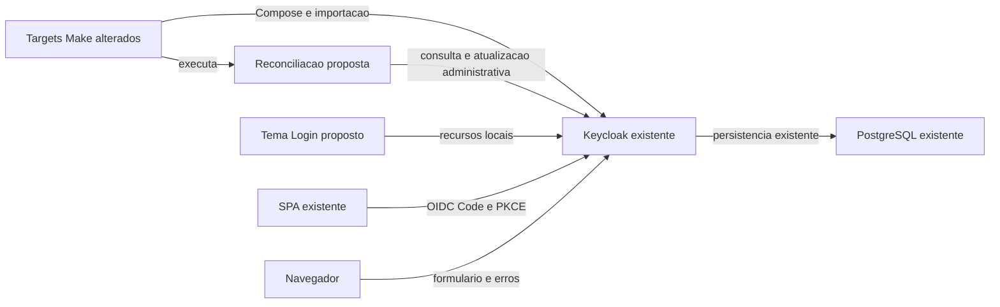
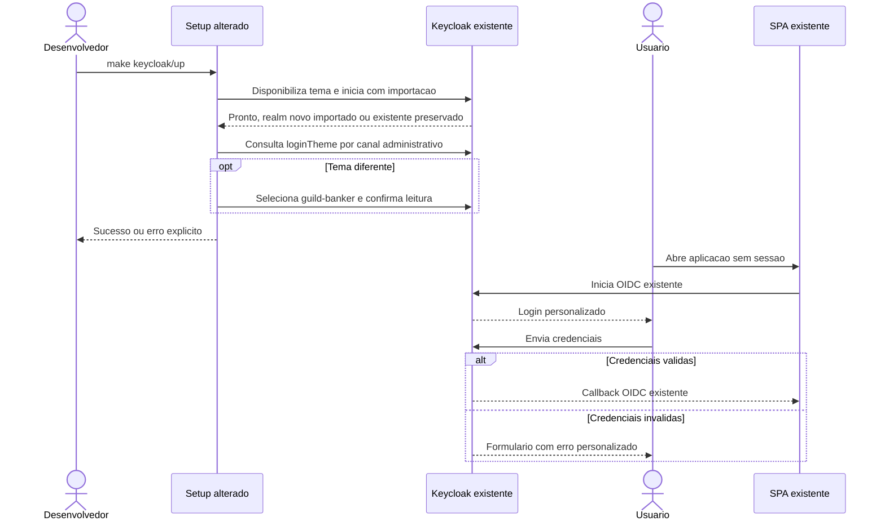

# ISSUE-6 — Tema de login GuildBanker no Keycloak

## Objetivo
Oferecer login e erros com a identidade visual do GuildBanker e aplicar o tema automaticamente no setup local do realm `guild-banker`, novo ou existente.

## Contexto e decisões
Origem: demanda fornecida pelo usuário nesta conversa em 2026-11-13, identificada como ISSUE-6; sem consulta ao Jira.

**Fatos verificados no HEAD `07228341b1f33a39f0f5aa144954a97ff3bd6454`, branch `main`:**
- `Makefile`, alvos `keycloak/up`, `setup` e `dev`: setup e desenvolvimento chamam o bootstrap do Keycloak; `keycloak/up` prepara o JSON e aguarda a prontidão do Compose.
- `infra/keycloak/prepare.py`, `main`: combina realm e clients sem resolver a senha no host. `infra/keycloak/guild-banker-realm.json`, realm `guild-banker`: não declara `loginTheme`; cadastro está desabilitado.
- `infra/keycloak/docker-compose.import.yml`, serviço `keycloak`: monta somente a importação e usa `--import-realm`. `infra/docker-compose.yml` fixa Keycloak 26.8.2 e credenciais administrativas locais de desenvolvimento.
- `infra/keycloak/README.md`, seção de realms existentes: importação de startup não atualiza realms existentes; não há atualização administrativa automática do tema.
- `web/prototype/DESIGN.md`, tokens e Layout: identidade GuildBanker com Inter, azul #0052ff, inputs 12px, cards 24px e ações pill. `web/prototype/screens/login.html`, painéis `login-form-panel-a1b2c3` e `login-hero-dark-v4w5x6`: referência visual em duas colunas, formulário claro e hero escuro.
- `web/spa/e2e/auth.spec.ts`, `login`: suíte real usa `#username`, `#password` e `#kc-login`; `web/spa/playwright.auth.config.ts` desabilita gravação de artefatos com credenciais.

**Decisões confirmadas:**
- D1 — Q1: aplicar automaticamente também no realm existente, preservando usuários e demais configurações. Resposta do usuário: “Q1. Sim”.
- D2 — Q2: personalizar login e erros; demais telas herdadas, sem habilitar novos fluxos. Resposta do usuário: “Q2. - Login e erros”.

**Propostas técnicas para aprovação nesta revisão:**
- D3 — Tema de tipo Login chamado `guild-banker`, herdando tema nativo compatível com 26.8.2 e sobrescrevendo somente o necessário. Preservar processamento e URLs gerados pelo Keycloak. Sem aplicação React separada ou dependência de build adicional.
- D4 — Priorizar o design específico de `web/prototype/DESIGN.md` e o layout do protótipo sobre valores genéricos divergentes do catálogo `web/spa/STYLE_GUIDE.md`. Painel claro com marca, título, campos e CTA; hero escuro no desktop. Mobile prioriza formulário sem rolagem horizontal. Remover do conceito visual o botão intermediário “Entrar com Keycloak” e o acesso demo: o formulário já estará no provedor de identidade.
- D5 — Seleção por `loginTheme=guild-banker` na criação inicial e reconciliação administrativa restrita a esse atributo após prontidão em `make keycloak/up`, propagada a `make setup` e `make dev`. Se já selecionado, não escrever novamente. Não alterar o comportamento de importação dos demais recursos. `make infra/up` permanece fora do bootstrap do realm.
- D6 — Usar o canal administrativo oficial do Keycloak com as credenciais locais configuradas no ambiente do serviço; não criar nova identidade administrativa. Operação com tempo limitado, falha explícita e leitura de confirmação. Erro de aplicação do tema faz o alvo falhar, sem anunciar setup completo; repetir o alvo consulta o estado antes de escrever. Não expor senhas ou tokens em logs nem persistir sessão administrativa na árvore versionada.
- D7 — Conteúdo próprio em pt-BR como referência inicial, mantendo mensagens e mecanismo nativo de localização nas telas herdadas; não mudar a política de idiomas do realm. Servir CSS, fontes e imagens localmente pelo tema, sem CDNs. Valores visuais centralizados em tokens CSS.

## Critérios de aceite
- **CA1:** Login exibe marca GuildBanker, Inter, azul #0052ff nas ações, canvas branco e painel editorial escuro no desktop conforme a referência; cards 24px, campos 12px e botões pill. Em 375px e desktop 1440px, formulário permanece legível e utilizável, sem rolagem horizontal.
- **CA2:** Credenciais inválidas e página de erro do fluxo de login mantêm a identidade visual, exibem mensagem compreensível e usam apenas ações de recuperação fornecidas pelo Keycloak quando disponíveis. Campos têm labels, foco visível, navegação por teclado e erros associados/acessíveis; a cor não é o único indicador de erro.
- **CA3:** O tema preserva o login real Authorization Code + PKCE do client `guild-banker-ui`, os seletores usados pela suíte existente, o retorno à SPA e o logout/SSO. Telas auxiliares são herdadas e continuam renderizando; cadastro, recuperação de senha, MFA e provedores externos não são habilitados por esta entrega.
- **CA4:** Executar `make keycloak/up` em instalação nova disponibiliza os recursos do tema e cria o realm com `loginTheme=guild-banker`, sem seleção manual no console; `setup` e `dev` usam o mesmo caminho.
- **CA5:** Em realm existente, o mesmo alvo seleciona o tema automaticamente; uma segunda execução mantém o resultado. Usuários, senhas, clients, roles, políticas e outros realms são preservados; não há exclusão de volumes, overwrite ou recriação de realm.
- **CA6:** Falha de autenticação administrativa, indisponibilidade ou falha de atualização/confirmacão resulta em erro explícito do setup, com espera limitada e sem exposição de credenciais. Documentação informa aplicação inicial/existente, pré-requisitos e retorno pontual ao tema anterior.

## Aprovação
Revisão 1 — aprovada em 2026-11-13 pelo usuário, resposta “Sim” ao pedido conjunto de aprovação e autorização de implementação nesta conversa. Implementação autorizada.

## Fora do escopo
Temas de Account/Admin/Email/Welcome, personalização das demais telas auxiliares, novos fluxos de autenticação, mudanças de autorização, API ou domínio financeiro, nova página de login na SPA, modo demo no Keycloak, publicação/deploy e configuração de ambientes de produção.

## Premissas e riscos
| # | Descrição | Evidência/motivo | Impacto | Validação/mitigação | Situação |
|---|---|---|---|---|---|
| P1 | Bootstrap administrativo local dispõe de credenciais válidas | Compose fornece bootstrap; credenciais podem ter mudado num volume existente | Setup falha quando não puder autenticar | Configuração documentada, sem reset de admin/realm | premissa operacional |
| P2 | Templates dependem da versão do Keycloak | Compose fixa 26.8.2 | Upgrade pode exigir ajuste | Herança nativa e execução real na versão fixada | risco conhecido |
| P3 | CSS compartilhado pode afetar telas herdadas | Herança de tema Login | Regressão visual ou funcional fora do login | Limitar overrides e fazer smoke de tela auxiliar em instância isolada | risco conhecido |
| P4 | Integração precisa de Docker, portas e senha local | Makefile e README Keycloak | Ambiente indisponível impede evidência real | Testar realms novo/existente em ambiente isolado, nunca limpar volume compartilhado | premissa operacional |
| P5 | QA visual depende de avaliação humana | CA1 e CA2 | Testes automatizados não aprovam fidelidade visual | Analista/usuário valida desktop, mobile, teclado e erros | pendente na implementação |

## Arquitetura da solução
### Visão geral
**Existentes:** SPA, Keycloak 26.8.2, banco persistente, definições JSON e targets Make. **Propostos:** recursos de tema Login versionados e extensão do setup para seleção administrativa pontual. **Alterados:** disponibilização de recursos no Compose, seleção inicial no JSON e conclusão de `keycloak/up`.

O Keycloak continua recebendo as credenciais e conduzindo OIDC. O tema trata apresentação; a SPA e a API mantêm seus contratos. A reconciliação local atua somente no realm `guild-banker`, confirma o valor atual e atualiza apenas `loginTheme` quando necessário. Não há mudança de schema ou transação de domínio. Preservação de campos omitidos deve ser comprovada na versão fixada, não inferida apenas do sucesso HTTP.

Base oficial: [temas e herança](https://www.keycloak.org/ui-customization/themes), [importação de startup](https://www.keycloak.org/server/importExport) e [Admin REST API 26.8.2](https://www.keycloak.org/docs-api/26.8.2/rest-api/index.html), consultados em 2026-11-13. O mecanismo concreto de acesso administrativo fica com o implementador, mantendo D5/D6.

### Diagrama arquitetural

### Jornada

Sintaxe Mermaid não validada. Rastreabilidade consolidada na matriz de verificação final.

## Tasks
| Task | Título | Status | Validação | Depende de | Risco | Repositório |
|---|---|---|---|---|---|---|
| T1 | Tema de login e erros com identidade GuildBanker | ✅ concluida | impedida | nenhuma | alto | `.` |
| T2 | Aplicação automática no setup de realms novos e existentes | ⬜ pendente | pendente | T1 | alto | `.` |

### T1 — Tema de login e erros com identidade GuildBanker
- **Entrega:** Tema Login disponível na distribuição local, com login e erros personalizados, recursos locais e fallback nativo nas demais telas. Pode ser selecionado em instância isolada antes da automação de T2.
- **Decisões e contratos:** D2, D3, D4 e D7; nome de tema `guild-banker`; contratos OIDC preservados.
- **Pontos de partida:** `web/prototype/DESIGN.md` e painéis de `web/prototype/screens/login.html` — visual; serviço `keycloak` em `infra/keycloak/docker-compose.import.yml` — disponibilização; `login` em `web/spa/e2e/auth.spec.ts` — contrato real.
- **Critérios de aceite:**
  - T1-AC1 Login corresponde aos tokens e composição da referência e funciona em 375px/1440px com assets locais → CA1.
  - T1-AC2 Credenciais inválidas e página de erro exibem identidade, mensagem e navegação acessíveis, sem alterar ações do servidor → CA2.
  - T1-AC3 Login, retorno e logout reais continuam passando; seletores existentes e fallback de tela auxiliar são preservados, sem habilitar fluxos → CA3.
- **Verificação:** `npm --prefix web/spa run test:e2e:auth` na raiz com tema selecionado em Keycloak isolado compatível com a configuração da suíte, API atual e banco de teste preparados. Acrescentar verificações comportamentais proporcionais de erro e tema à cobertura real. QA manual obrigatório: comparação com protótipo, mobile/desktop, teclado, labels, foco e erro; registrar avaliação por analista/usuário. Não capturar credenciais nos artefatos.

### T2 — Aplicação automática no setup de realms novos e existentes
- **Entrega:** `keycloak/up` conclui com o tema selecionado tanto em primeira instalação quanto em volume existente, com falha observável quando não conseguir aplicar/confirmar. README descreve operação e reversão pontual.
- **Decisões e contratos:** D1, D5 e D6; seleção `loginTheme=guild-banker`, somente no realm homônimo. Preservar os demais atributos e recursos.
- **Pontos de partida:** alvos `keycloak/up`, `setup`, `dev` no `Makefile`; `main` em `infra/keycloak/prepare.py`; realm em `infra/keycloak/guild-banker-realm.json`; serviço no overlay `infra/keycloak/docker-compose.import.yml`; procedimento em `infra/keycloak/README.md`.
- **Critérios de aceite:**
  - T2-AC1 Importação inicial já seleciona o tema disponível; setup e dev percorrem o mesmo bootstrap → CA4.
  - T2-AC2 Realm existente com tema diferente recebe somente a seleção prevista; repetir não faz nova atualização quando já correto. Comparação antes/depois confirma preservação de usuários, credenciais funcionais, clients, roles, políticas e outro realm → CA5.
  - T2-AC3 Falhas administrativas e de confirmação encerram setup com erro e duração limitada; execução posterior consulta o estado. Saída e arquivos versionados não contêm credenciais ou tokens; documentação cobre pré-requisitos e reversão somente do tema → CA6.
- **Verificação:** `make keycloak/validate` e `make keycloak/prepare` na raiz; `docker compose -f docker-compose.yml -f keycloak/docker-compose.import.yml config --quiet` em `infra` com ambiente local configurado. Exercitar `make keycloak/up` em instalação nova e existente isoladas, incluindo repetição e falhas; adicionar cobertura direcionada da reconciliação (comando a definir junto ao mecanismo escolhido). Inspecionar encadeamento de `setup`/`dev`; não executar limpeza de volumes compartilhados. Reexecutar a suíte real de autenticação após automação.

## Verificação final
Comandos confirmados no repositório, na raiz salvo indicação:
1. `make keycloak/validate` — validação estática sem Docker.
2. `make keycloak/prepare` — gera JSON ignorado pelo Git; inspecionar seleção e placeholder de senha.
3. `docker compose -f docker-compose.yml -f keycloak/docker-compose.import.yml config --quiet`, em `infra` — requer senha local por ambiente/arquivo ignorado.
4. `make keycloak/up` — somente em ambiente de teste isolado, com Docker e configuração válidos; verificar realm novo, existente, repetição e erros.
5. `npm --prefix web/spa run test:e2e:auth` — API atual, banco de teste e Keycloak local compatíveis com a configuração da suíte; senha por ambiente e membership de teste ou opt-in existente para criação em banco dedicado.

| CA | Task(s) | Evidência esperada |
|---|---|---|
| CA1 | T1 | Avaliação visual desktop/mobile e recursos locais sem erros |
| CA2 | T1 | Erro de credenciais/página de erro, labels, foco e teclado avaliados |
| CA3 | T1 | Suíte OIDC real aprovada e smoke de fallback em instância isolada |
| CA4 | T2 | Instalação nova com tema ativo; inspeção do encadeamento Make |
| CA5 | T2 | Estado antes/depois, credencial ainda funcional e segunda execução sem atualização |
| CA6 | T2 | Falhas verificadas com tempo limitado e sem segredos; README revisado |

Gates Go não aplicáveis: não se prevê alterar Go. Se a implementação modificar código da SPA, executar os gates correspondentes confirmados em `web/spa/package.json`. Checklist: recursos locais, design específico, templates sem lógica de negócio, OIDC nativo, segredos fora de logs/Git, atualização administrativa restrita e revisão independente das tasks de risco alto. QA humano pendente impede validação completa.

Revisão de planejamento: requisitos, engenharia e qualidade conferidos pelo coordenador; não substitui revisão independente da implementação. Nenhum commit, publicação, execução de setup ou validação funcional realizados no planejamento. Medição indisponível: início do tooling falhou com `source_sha` inválido; não há journal válido nem tempos/tokens medidos.

## Decisões da implementação
- DM1 — T1, 2026-11-13: herdar `keycloak` e compor somente login/erro com um wrapper do layout nativo; templates derivados de 26.8.2 preservam scripts e ações. CSS limitado por `data-page-id`; fontes copiadas das dependências já instaladas com licenças OFL. Aplica D2–D4/D7 sem novo build.
- DM2 — T2, 2026-11-13: usar `kcadm.sh` dentro do serviço com sessão temporária e `timeout` da imagem; `--no-merge` envia somente `loginTheme`. Variáveis oficiais de bootstrap passam a aceitar override no Compose, mantendo defaults locais. Aplica D5/D6 sem reset de administrador existente.
- DM3 — T1, 2026-11-13: matcher de resposta de despesas na suíte real passa a comparar `URL.pathname`, mantendo a asserção HTTP 200. A versão anterior falhou igualmente com tema nativo por ignorar a query preexistente `include_paused=true`; ajuste necessário para executar a validação prevista, sem mudança de produto.
- DM4 — Validação formal impedida pela ausência de restrição efetiva de escrita nos subagentes revisores, apesar dos pareceres técnicos independentes favoráveis e correção de R1. [Roteiro de QA](./ISSUE-6-roteiro-qa.md) registra avaliação humana visual e revisão humana com SHA como pendentes. Aprovação de spec não equivale a esses resultados.
- DM5 — Ambiente de integração: projeto Compose exclusivo `guildbanker-issue6`, cópia temporária da infra com somente nomes de contêineres e porta PostgreSQL adaptados para evitar colisões com contêineres parados preexistentes. Nenhum volume compartilhado foi limpo. API de teste usa banco desse projeto.
