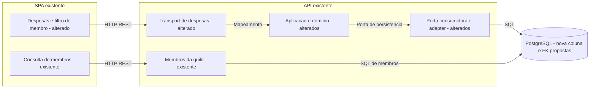

# ISSUE-7 — Responsável pela despesa fixa e filtro por membro

## Objetivo
Permitir atribuir opcionalmente uma despesa fixa a um membro da guild e filtrar as despesas por responsável ao lado do filtro de categoria.

## Contexto e decisões
- Origem: demanda fornecida pelo usuário nesta conversa; sem consulta a um serviço externo de issues. Refinamento Q1–Q3 respondido pelo usuário em 2026-11-13.
- Base verificada: `07228341b1f33a39f0f5aa144954a97ff3bd6454` (`main` local). Worktree da implementação: branch `feat/issue-7-responsavel-despesa-fixa`, criada sem incorporar alterações locais da issue-6.
- Fatos verificados:
  - `FixedExpense` (`api/internal/fixed_expense/fixed_expense.go`) ainda não possui responsável; `Service.Create` e `Service.Update` (`api/internal/fixed_expense/service.go`) autorizam qualquer membro da guild a operar despesas compartilhadas.
  - `guild_member` (`api/migrations/000001_create_users_table.up.sql`) tem chave primária composta por `guild_id` e `user_id`; `postgresStorage.RemoveMember` (`api/internal/guild/storage.go`) remove esse vínculo.
  - `useGuildMembers` (`web/spa/src/features/guilds/api/use-guilds.ts`) já consulta membros com cache por usuário/guild. A rota existente é GET `/api/v1/guilds/{id}/members`, documentada em `docs/specs/openapi.yaml`.
  - `FixedExpensesPageClient` (`web/spa/src/features/fixed-expenses/components/fixed-expenses-page-client.tsx`) filtra categoria localmente e passa o resultado a `monthlyTotal` (`web/spa/src/features/fixed-expenses/monthly-total.ts`), que soma apenas despesas ativas.
- Decisões confirmadas:
  - D1 (Q1): responsável opcional; não altera quem pode ler ou operar a despesa.
  - D2 (Q2): despesas existentes permanecem sem responsável, sem inferir pelo criador.
  - D3 (Q3): remover um membro limpa sua atribuição nas despesas da guild e preserva as despesas.
- Decisões aprovadas na revisão 1:
  - D4: usar `responsible_user_id`, ID do usuário na lista de membros, como campo opcional e anulável nas requisições e anulável nas respostas. POST omitido ou null cria sem responsável; PATCH omitido preserva, null limpa, inteiro positivo atribui. Não aceitar zero, negativos, tipos inválidos ou IDs que não sejam membros da guild.
  - D5: exibir o nome do responsável na listagem e um seletor na criação/edição, com opção “Sem responsável”. Reutilizar a lista de membros da guild; não adicionar nomes ou e-mails ao payload da despesa.
  - D6: filtro local com opções “Todos os membros”, “Sem responsável” e membros atuais. Combinar categoria e responsável por interseção; o total soma apenas ativas do resultado. Limpar a seleção de membro ao trocar de guild e não apresentar dados de outra guild.
  - D7: acrescentar migration incremental com `fixed_expense.responsible_user_id BIGINT NULL` e integridade referencial composta para `guild_member(guild_id, user_id)`. A remoção da associação deve anular somente `responsible_user_id`, preservando `guild_id`. PostgreSQL 17+ permite implementar esse comportamento na FK; desenho interno fica com a implementação. Não reescrever migrations aplicadas.

## Aprovação
Revisão 1 — aprovada em 2026-11-13 pelo usuário na mensagem “Pode seguir com a implementação”; implementação autorizada. D1–D7 e CA1–CA7 aprovados. Sem autorização de push, publicação ou merge.

## Critérios de aceite
- CA1: criar, consultar e editar despesas com um único responsável opcional da mesma guild; editar sem enviar o campo preserva o valor, e enviar null limpa a atribuição.
- CA2: despesas existentes continuam disponíveis sem responsável; clientes que omitem o novo campo continuam funcionando.
- CA3: atribuição inválida ou a não membro da guild retorna 400 sem alterar a despesa; autorização do requisitante e isolamento por guild permanecem vigentes, incluindo 403 para não membro e 404 para despesa fora do escopo.
- CA4: remover o membro limpa atomicamente suas atribuições nessa guild, mantém todas as despesas e os demais dados financeiros, e não modifica suas atribuições em outras guilds. Não pode restar atribuição inválida em disputa entre remoção e criação/edição.
- CA5: criação e edição oferecem seleção entre os membros da guild e “Sem responsável”; listagem mostra a atribuição após salvar e recarregar.
- CA6: filtro por membro aparece ao lado do filtro de categoria em telas largas, adapta-se em telas estreitas e permite todos, sem responsável ou um membro. Filtros combinam por interseção; estado vazio e total mensal correspondem ao resultado, somando apenas ativas.
- CA7: troca de guild e respostas tardias não misturam membros, filtros, drafts ou despesas entre guilds. Loading/erro da consulta de membros são visíveis; uma falha não pode limpar silenciosamente a atribuição salva. Controles têm rótulos acessíveis e textos nos idiomas já suportados.

## Fora do escopo
Rateio, múltiplos responsáveis, pagamentos, alteração de permissões, notificações, atribuição automática ao criador e novos filtros de servidor.

## Premissas e riscos
| # | Descrição | Evidência/motivo | Impacto | Validação/mitigação | Situação |
|---|---|---|---|---|---|
| P1 | Responsável é atribuição organizacional, sem novas permissões | Demanda e serviço compartilhado atual | Evitar restrição de edição indevida | Regressão com dois membros | premissa |
| P2 | Integridade entre guild, usuário e despesa exige proteção no banco | Remoção e gravação são operações independentes | Vínculo cruzado ou órfão em concorrência | FK composta e testes reais de remoção/gravação | proposto |
| P3 | PostgreSQL 17+, banco exclusivo e DSNs corretos são necessários | Suítes PostgreSQL existentes | Sem banco não há evidência de integridade | Configurar ambiente isolado; não resetar banco compartilhado | pendente operacional |
| P4 | Schema, API e SPA devem ser entregues em conjunto | Novo campo persiste em banco | API nova exige migration aplicada | Testar upgrade e geração de tipos | proposto |
| P5 | Revisão independente é obrigatória para T1 | Contrato público, integridade e isolamento | Implementação pronta não basta para validação | Revisão conforme dev-mage; registrar limites do ambiente | pendente |

## Arquitetura da solução
### Visão geral
**Existente:** SPA consulta API autenticada; handlers chamam aplicação, aplicação usa portas consumidoras, adaptadores PostgreSQL persistem entidades. O módulo de guild já fornece a lista de membros e a remoção.

**Alterado:** domínio da despesa representa atribuição opcional sem tags de infraestrutura; aplicação valida o responsável no escopo da guild após autorizar o requisitante; transport distingue campo ausente de null no PATCH e mapeia erros. Adaptador persiste o campo e traduz violação do vínculo para erro de entrada apropriado, sem mascarar falhas técnicas. A FK garante integridade inclusive sob concorrência e executa a limpeza na remoção do vínculo. Remover responsável não reescreve autoria de criação nem valores, vencimento, categoria ou status.

**Proposto:** mudança aditiva nos contratos POST/GET/PATCH das rotas existentes de despesas fixas, incluindo a resposta da consulta individual quando aplicável ao transporte existente, sem criar endpoints novos. Respostas de despesa passam a incluir `responsible_user_id: integer | null`. OpenAPI, tipos gerados, fixtures e contratos de mocks acompanham a mudança. A SPA resolve nomes pelos membros e filtra localmente, seguindo o filtro de categoria. Falha na resolução de nomes não é apresentada como ausência de responsável.

### Diagrama arquitetural

### Jornada
1. Membro abre despesas da guild, escolhe responsável no formulário e salva; a API autoriza o ator, valida o vínculo e persiste.
2. A listagem recarregada mostra a atribuição; selecionar membro e categoria restringe lista e total mensal.
3. Remover o membro pela ação existente limpa suas atribuições na mesma operação do banco. Após refetch, as despesas aparecem sem responsável.

Sintaxe Mermaid não validada. Não há dúvidas de negócio bloqueantes; D4–D7 aprovadas na revisão completa.

## Tasks
| Task | Título | Status | Validação | Depende de | Risco | Repositório |
|---|---|---|---|---|---|---|
| T1 | Persistir e expor o responsável com integridade por guild | ✅ concluida | impedida | nenhuma | alto | `.` |
| T2 | Selecionar, exibir e filtrar o responsável na SPA | ✅ concluida | aprovada | T1 | normal | `.` |

### T1 — Persistir e expor o responsável com integridade por guild
- **Entrega:** atribuição opcional disponível na API, migration compatível com dados existentes e limpeza atômica na remoção do membro, sem alterar as permissões atuais.
- **Decisões e contratos:** D1–D4 e D7; novo campo `responsible_user_id` em POST/PATCH e respostas das rotas existentes `/api/v1/guilds/{guildID}/fixed-expenses` e `.../{id}`. Não introduzir GET individual se não existir. PATCH diferencia ausente/null/ID; erros de atribuição são 400, preservando os demais códigos existentes.
- **Pontos de partida:** `Service.Create`, `Service.Update` e `Storage` (`api/internal/fixed_expense/service.go`); `fixedExpenseEntity` (`api/internal/fixed_expense/storage.go`); `postgresStorage.RemoveMember` (`api/internal/guild/storage.go`); `guild_member` (`api/migrations/000001_create_users_table.up.sql`); `docs/specs/openapi.yaml`.
- **Critérios de aceite:**
  - T1-AC1: round-trip de criação, leitura e edição com ID/null, PATCH omitido preservando e null limpando; status e auditoria existentes preservados → CA1, CA2.
  - T1-AC2: migration incremental em schema anterior mantém despesas sem responsável; requests antigos continuam aceitos; OpenAPI, tipos gerados e fixtures/mocks consumidores coerentes e gates da SPA passando → CA2.
  - T1-AC3: IDs inválidos, de outra guild e não membros são rejeitados sem mutação; ator não membro e ID de despesa fora da guild mantêm semântica atual → CA3.
  - T1-AC4: integração PostgreSQL comprova limpeza na remoção, preservação das despesas e de outra guild e ausência de atribuições órfãs em concorrência com gravação → CA4.
- **Verificação:** em `api`, `go test ./internal/fixed_expense ./internal/guild -race -count=1` e `go test ./internal/fixed_expense ./internal/guild -race -count=1 -tags=integration,postgres`. Configurar `FIXED_EXPENSE_TEST_DATABASE_URL` e `GUILD_TEST_DATABASE_URL` para banco exclusivo PostgreSQL 17+. Atualizar fixtures de integração para aplicar a nova migration. Na raiz, `npm --prefix web/spa run api:types` e gates de contrato/build/teste abaixo. Esperado: contratos compatíveis e testes de comportamento cobrindo atribuição e remoção reais; mocks não substituem prova de FK.

### T2 — Selecionar, exibir e filtrar o responsável na SPA
- **Entrega:** formulário com responsável opcional, atribuição visível na tabela e filtro por membro ao lado de categoria, com lista e total coerentes.
- **Decisões e contratos:** D1, D5 e D6; consumir `responsible_user_id` de T1 e GET existente de membros. Remoção do membro invalida os dados de despesas afetados para o próximo refetch; não criar sincronização em tempo real.
- **Pontos de partida:** `FixedExpensesPageClient`, `FixedExpenseModal`, `FixedExpenseTable` e `FixedExpenseRow` (`web/spa/src/features/fixed-expenses/components/`); `monthlyTotal` (`web/spa/src/features/fixed-expenses/monthly-total.ts`); `useGuildMembers` e `useRemoveMember` (`web/spa/src/features/guilds/api/use-guilds.ts`).
- **Critérios de aceite:**
  - T2-AC1: criar/editar/limpar responsável persiste e aparece corretamente após recarregar; despesas antigas exibem “Sem responsável”; alteração de status não limpa atribuição → CA1, CA2, CA5.
  - T2-AC2: filtrar por todos, sem responsável e membro combina com categoria por interseção; total inclui só ativas do resultado e vazio filtrado usa mensagem apropriada → CA6.
  - T2-AC3: seletor e filtro respondem a loading/erro, sem sobrescrever responsável por falha de consulta; troca de guild limpa filtro e não mistura drafts/opções/respostas tardias; textos traduzidos e controles acessíveis a 375 e 1280 px → CA7.
  - T2-AC4: remoção de membro seguida de recarga mostra suas despesas preservadas sem responsável → CA4, CA5.
- **Verificação:** na raiz, `npm --prefix web/spa test`, `npm --prefix web/spa run test:e2e -- e2e/fixed-expenses.spec.ts e2e/guild-context.spec.ts e2e/guild-members.spec.ts`. Cobrir seleção, persistência simulada, combinação dos filtros, total, vazio, troca de guild e erros; provas de integridade continuam em T1. Gates comuns abaixo.

## Verificação final
Comandos confirmados no `Makefile`, `web/spa/package.json` e nas suítes existentes; evidências abaixo são esperadas, ainda não executadas nesta spec.

- Na raiz: `make api/vet`, `make api/lint`, `make api/test`, `make api/test/integration`, `make api/build`.
- Em `api`: `go test ./... -race -count=1 -tags=integration,postgres`, com PostgreSQL 17+ exclusivo e `FIXED_EXPENSE_TEST_DATABASE_URL`, `GUILD_TEST_DATABASE_URL`, `USER_TEST_DATABASE_URL` adequados. Não executar down/reset em banco compartilhado.
- Na raiz, após geração dos tipos: `npm --prefix web/spa run api:types:check`, `npm --prefix web/spa run lint`, `npm --prefix web/spa run build`, `npm --prefix web/spa test`, `npm --prefix web/spa run test:e2e`, `npm --prefix web/spa run test:e2e:prod`.
- Pré-requisitos: toolchains do projeto, dependências declaradas instaladas, Chromium e portas livres; build com configuração pública OIDC conforme ambiente. Serviços já ligados não comprovam schema/DSNs corretos.
- QA manual obrigatório: não aplicável; os comportamentos desta entrega devem ser cobertos por testes de aplicação/HTTP/PostgreSQL e testes de UI/E2E. Inspeção visual opcional a 375/1280 px complementa os testes.
- Revisão da spec: conferida quanto a requisitos, engenharia e qualidade; não equivale à aprovação do usuário nem à revisão independente do código.

| CA | Task(s) | Evidência esperada |
|---|---|---|
| CA1 | T1, T2 | HTTP/serviço/round-trip PostgreSQL e formulário E2E |
| CA2 | T1, T2 | Upgrade da migration com dados, requests antigos e estado sem responsável |
| CA3 | T1 | Matriz ator/guild/responsável e ausência de mutação em falhas |
| CA4 | T1, T2 | Remoção e concorrência reais no PostgreSQL; UI após recarga |
| CA5 | T2 | Seleção/edição/limpeza e nome na tabela após refetch |
| CA6 | T2 | Interseção, opções, total ativo, vazio e layout responsivo |
| CA7 | T2 | Erros/loading, rótulos/idiomas, guild trocada e respostas tardias |

Checklist de convenções: manter transport → aplicação → domínio e adapters implementando portas consumidoras; domínio sem tags de infraestrutura; contexto propagado; erros classificáveis sem comparação textual; SQL parametrizado; nenhuma nova dependência, estado global ou pacote genérico.

## Decisões da implementação
- DM1 — T1 (2026-11-13): preservar a assinatura existente de `Service.Create` delegando para `CreateWithResponsible`; o HTTP usa a nova entrada explícita. Compatibilidade local sem alterar callers antigos.
- DM2 — T1 (2026-11-13): FK composta com `ON DELETE SET NULL (responsible_user_id)` e índice parcial por guild/responsável materializam D7, sem mudar o serviço de remoção nem apagar a despesa. A migration 5 é incremental; as anteriores permanecem intactas.
- DM3 — T1 (2026-11-13): validação independente permanece impedida até revisão humana do snapshot ou ambiente com revisor efetivamente sem ferramentas de escrita; revisão em contexto isolado com ferramentas não restritas não certifica esse requisito.
- DM4 — T2 (2026-11-13): reutilizar o remount por guild existente e o cache por usuário/guild; erro 403 de membros substitui imediatamente tabela/modal por acesso negado, e erro técnico preserva o responsável salvo. Remoção invalida somente as despesas da guild afetada. Sem alteração de permissões.
