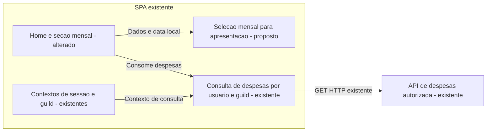

# ISSUE-8 — Próximos gastos fixos do mês na home

## Objetivo
Exibir na home pós-login até cinco despesas fixas ativas da guild selecionada, priorizando os vencimentos mais próximos entre hoje e o fim do mês.

## Contexto e decisões
- Origem: demanda fornecida pelo usuário nesta conversa; identificador solicitado: issue-8. Sem consulta a serviço externo de issues.
- Fatos verificados no HEAD `6a5442dc75a0b544884d12938e064f7266895f34`:
  - `HomePage` (`web/spa/src/features/home/components/home-page.tsx`) exibe somente a saudação. `AuthenticatedApp` (`web/spa/src/app/app.tsx`) exige sessão e guild válida antes de montar as páginas.
  - `useFixedExpenses` e `fixedExpenseKeys` (`web/spa/src/features/fixed-expenses/api/use-fixed-expenses.ts`) consultam despesas com cache por usuário/guild, cancelamento da sessão e invalidação após mutações.
  - `fixedExpensesApi.list` (`web/spa/src/features/fixed-expenses/api/fixed-expenses.api.ts`) usa GET `/api/v1/guilds/{guildID}/fixed-expenses` com `include_paused=true`; a home precisa selecionar apenas `ACTIVE`.
  - `FixedExpenseResponse` (`web/spa/src/features/fixed-expenses/types.ts`, derivado da OpenAPI) disponibiliza nome, valor, status e dia do vencimento. O cadastro permite dias de 1 a 31, conforme `createFixedExpenseSchema` em `web/spa/src/features/fixed-expenses/schemas/fixed-expense.schema.ts`.
- Decisões confirmadas pelo usuário na resposta “Q1. siga com a recomendada; Q2. recomendada”:
  - D1 (Q1): considerar apenas o restante do mês corrente, incluindo hoje. Não completar a lista com o mês seguinte; mostrar menos de cinco quando necessário.
  - D2 (Q2): usar a data local do navegador ao abrir a home, em vez de fixar o dia da autenticação. Reabrir/recarregar a home deve considerar a nova data, inclusive após virada de mês; não exige novo login. Atualização automática à meia-noite com a tela continuamente aberta fica fora do escopo.
- Propostas para aprovação nesta revisão:
  - D3: considerar todas as despesas `ACTIVE` da guild selecionada, independentemente do responsável. Ordenar pela data efetiva de vencimento crescente e desempatar por ID crescente, limitando a cinco após filtrar e ordenar. Não alterar a ordem dos dados compartilhados no cache.
  - D4: para dia cadastrado inexistente no mês (29, 30 ou 31), apresentar e ordenar pelo último dia daquele mês. Essa projeção vale apenas para esta seção e não modifica o cadastro. Exemplo: dia 31 em fevereiro de 2027 aparece como 28/02/2027.
  - D5: criar a seção “Gastos fixos do mês” abaixo da saudação, identificando mês/ano e mostrando nome, valor em BRL e data efetiva de vencimento para cada item. Marcar vencimentos de hoje com texto “Hoje” e do dia seguinte com “Amanhã” (ajuste do usuário em CA1, revisão 2). Manter estilos, temas e traduções pt-BR/en já suportados pela SPA.
  - D6 (técnica): reutilizar a consulta, contratos e isolamento existentes. Fazer a seleção para apresentação na SPA; não criar endpoint, migration, dependência ou alteração na autenticação. Estados de carregamento, vazio, erro com nova tentativa e acesso negado devem ser explícitos; erro não equivale a ausência de gastos.

## Aprovação
Revisão 2 — aprovada pelo usuário na mensagem “ajustei um ponto na spec. Aprovado, siga com a implementação”, incluindo seu acréscimo de “Amanhã” em CA1; implementação autorizada. Q1 e Q2 confirmam D1 e D2. Sem autorização de push, publicação ou merge.

## Critérios de aceite
- CA1: a home pós-login apresenta a seção “Gastos fixos do mês” abaixo da saudação, com mês/ano, nome, valor em BRL e vencimento efetivo dos itens. Vencimentos de hoje são identificados como “Hoje”, do dia seguinte são identificados como “Amanhã”.
- CA2: listar no máximo cinco despesas `ACTIVE` da guild selecionada, com vencimento efetivo de hoje até o último dia do mês, em ordem crescente de vencimento e depois ID. Excluir pausadas, canceladas e dias passados; não completar com o próximo mês.
- CA3: com menos de cinco elegíveis, mostrar apenas as disponíveis; com zero, apresentar mensagem de que não há próximos gastos fixos neste mês. Carregamento e falha de consulta possuem estados distintos do vazio, com nova tentativa para falhas técnicas.
- CA4: usar a data local de abertura da home; ao reabrir/recarregar em outro dia ou mês, recalcular mesmo com dados em cache. Projetar dias inexistentes para o último dia do mês, incluindo fevereiro bissexto. Não mudar vencimentos salvos nem reordenar o cache compartilhado.
- CA5: seleção de guild, respostas tardias e troca de usuário não exibem despesas de outro contexto. Sem sessão ou guild válida não há consulta financeira; um 403 não mantém despesas em cache visíveis e apresenta acesso negado. Preservar os fluxos atuais de onboarding e sessão.
- CA6: seção legível em 375 e 1280 px, sem rolagem horizontal, com estrutura semântica, estados acessíveis e textos em pt-BR/en; manter saudação e navegação existentes.

## Fora do escopo
Pagamentos, determinação de atraso ou quitação, notificações, filtros adicionais, edição na home, novos totais, persistência da data do login e atualização automática à meia-noite.

## Premissas e riscos
| # | Descrição | Evidência/motivo | Impacto | Validação/mitigação | Situação |
|---|---|---|---|---|---|
| P1 | Data de referência é a local do navegador | Q2 confirmada | UTC pode produzir dia diferente | Testes com relógio controlado e cenário próximo da meia-noite local | confirmado |
| P2 | Cadastro representa recorrência, sem indicar pagamento do mês | Campos de `FixedExpenseResponse` | A lista não certifica que há dívida pendente | Usar linguagem de vencimento; não afirmar atraso ou quitação | premissa |
| P3 | Dias inexistentes exigem projeção explícita | Cadastro aceita até 31 | Rollover automático pode deslocar para outro mês | D4 e testes de meses curtos | proposta |
| P4 | Mocks de navegador não comprovam autorização real do servidor | Reuso do GET existente, sem mudar autorização | Evidência da entrega é de apresentação e consumo | Regressão de isolamento da SPA; revisão do delta sem alegar nova auditoria de backend | premissa |

## Arquitetura da solução
**Existente:** a SPA autentica, resolve a guild ativa e consulta a API pelo hook de despesas, usando cache por usuário/guild e cancelamento da sessão. O backend mantém a autorização e retorna as despesas pelos contratos atuais.

**Alterado/proposto:** a home consome esse hook, deriva a lista mensal sem mutar os dados compartilhados e renderiza a seção e seus estados. A data de referência pertence à apresentação; o backend e seus dados persistidos permanecem com o contrato atual. Reutilizar componentes e tokens do projeto sem acoplar a home às ações de edição da tabela completa.

Sintaxe Mermaid não validada. Sem integração externa nova ou mudança na persistência. As propostas D3–D6 integram a revisão submetida à aprovação.

## Tasks
| Task | Título | Status | Validação | Depende de | Risco | Repositório |
|---|---|---|---|---|---|---|
| T1 | Exibir os próximos gastos fixos do mês na home | ✅ concluida | aprovada | nenhuma | normal | `.` |

### T1 — Exibir os próximos gastos fixos do mês na home
- **Entrega:** seção funcional na home, com seleção mensal determinística, estados de consulta e apresentação responsiva e traduzida, acompanhada de testes de comportamento.
- **Decisões e contratos:** D1–D6; consumo do GET existente de despesas, sem alteração de payload, autenticação, schema ou permissões.
- **Pontos de partida:** `HomePage` (`web/spa/src/features/home/components/home-page.tsx`); `useFixedExpenses` e `fixedExpenseKeys` (`web/spa/src/features/fixed-expenses/api/use-fixed-expenses.ts`); `FixedExpensesPageClient` (`web/spa/src/features/fixed-expenses/components/fixed-expenses-page-client.tsx`) como referência para loading/erro/403; `resources` (`web/spa/src/shared/lib/i18n.ts`) para idiomas; testes de navegação em `web/spa/src/app/app.test.tsx` e `web/spa/e2e/guild-context.spec.ts`.
- **Critérios de aceite:**
  - T1-AC1: home exibe seção após a saudação, mês/ano e campos dos itens, incluindo indicação de hoje e amanhã; layout e traduções funcionam nos dois idiomas e nas larguras previstas → CA1, CA6.
  - T1-AC2: dados fora de ordem com mais de cinco elegíveis, empates e status mistos resultam nos cinco primeiros corretos; poucos elegíveis não são completados com o próximo mês; zero gera vazio apropriado → CA2, CA3.
  - T1-AC3: relógio controlado comprova hoje incluso, passado excluído, fim/início de mês e ano, fevereiro comum/bissexto e dias 30/31; reabrir a home recalcula a partir da data local mesmo com cache, preservando entrada e cadastro → CA2, CA4.
  - T1-AC4: carregamento, falha técnica e recuperação por nova tentativa são observáveis; 403 oculta dados previamente carregados, mostra acesso negado e preserva controles de identidade → CA3, CA5.
  - T1-AC5: troca de guild durante resposta pendente e troca de usuário não misturam despesas; ausência de sessão/guild válida impede consulta financeira; regressões de onboarding e navegação passam → CA5, CA6.
- **Verificação:** na raiz, `npm --prefix web/spa test` para regra de calendário e componente integrado com mocks/relógio controlados; `npm --prefix web/spa run test:e2e` para jornada da home, ordenação, troca de guild e responsividade com dados e data determinísticos. Gates comuns abaixo. Provas observam a lista e os estados públicos, sem espelhar detalhes internos.

## Verificação final
Comandos confirmados em `web/spa/package.json`, `web/spa/vitest.config.ts` e configurações Playwright. São verificações futuras, ainda não executadas nesta etapa documental.

- Na raiz: `npm --prefix web/spa run api:types:check`, `npm --prefix web/spa run lint`, `npm --prefix web/spa test`, `npm --prefix web/spa run build`, `npm --prefix web/spa run test:e2e`, `npm --prefix web/spa run test:e2e:prod` (após build).
- Pré-requisitos: dependências existentes, Chromium disponível e portas de teste livres (5173 ou `PLAYWRIGHT_PORT`; 4173 para preview). Não exige PostgreSQL ou Keycloak para as suítes simuladas; preview de produção usa a configuração pública OIDC adequada ao ambiente.
- Testes de API/migrations: não aplicáveis ao escopo proposto, pois não há mudança nesses componentes.
- QA manual obrigatório: não aplicável; cobrir calendário, estados e jornada com testes automatizados. Inspeção visual opcional complementa a evidência de layout.
- Revisão documental: conferidos requisitos, engenharia e qualidade; cada CA está coberto por T1, sem contrato novo. Isso não representa aprovação do usuário nem revisão do código.
- Convenções: mudança restrita à apresentação e seleção de dados da SPA; preservar fronteiras e contratos existentes, cache por contexto, cancelamento e dados monetários; sem dependências novas ou estado global mutável adicional.

| CA | Task(s) | Evidência esperada |
|---|---|---|
| CA1 | T1 | Componente e E2E com campos, mês/ano e indicação de hoje e amanhã |
| CA2 | T1 | Regra testada com ordenação, empates, status e limite de cinco |
| CA3 | T1 | Zero/poucos itens, loading, falha e recuperação |
| CA4 | T1 | Calendário local controlado, meses curtos, cache preservado e nova abertura |
| CA5 | T1 | Respostas tardias, guild/usuário, 403 com cache e ausência de contexto |
| CA6 | T1 | Idiomas, semântica, regressões de navegação e E2E em 375/1280 px |

## Registro do fluxo
Planejamento pela skill dev-quest e implementação pela dev-mage, coordenados pelo dev-flow. Medição indisponível: a tentativa de início em `/tmp/guild-banker-issue-8-run` foi recusada pelo tooling com `identificador inválido: source_sha`; não há journal válido ou métricas de tempo/tokens/custo. Evidências de implementação e gates serão preservadas no recibo do commit da task. Sem publicação ou merge.

## Decisões da implementação
- DM1 — T1: data local capturada na montagem da home; a projeção mensal é pura e não altera os objetos do cache. Navegar para outra página e voltar refaz a referência, inclusive durante revalidação de dados em cache.
- DM2 — T1: formatação de cada valor reutiliza `monthlyTotal` com um único item ativo, preservando a aritmética decimal em centavos já existente. Nenhum campo financeiro ou contrato foi alterado.
- DM3 — T1: acesso negado aparece na própria seção, sem link recursivo para a home; saudação e controles de identidade continuam disponíveis. Reutiliza o tratamento de 403 da consulta, sem modificar as permissões existentes.
