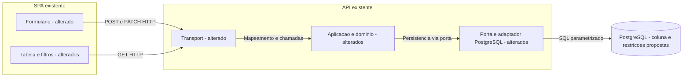

# ISSUE-9 — Forma de pagamento nas despesas fixas

## Objetivo
Registrar a forma de pagamento de cada despesa fixa e permitir sua identificação por badge e filtragem na tela de Despesas fixas.

## Contexto e decisões
- Origem: demanda fornecida pelo usuário nesta conversa em 2026-11-15, com decisões Q1 e Q2 confirmadas na mensagem seguinte. Nenhuma consulta ao Jira foi necessária.
- Fatos verificados no HEAD `88a3c5bd27f99e4417a3f80bee8bc4a5eb358cc8`, branch `main`, árvore inicialmente limpa:
  - `FixedExpense` (`api/internal/fixed_expense/fixed_expense.go`) ainda não representa forma de pagamento. `Service.Update` (`api/internal/fixed_expense/service.go`) preserva campos omitidos no PATCH.
  - `postgresStorage` (`api/internal/fixed_expense/storage.go`) persiste na tabela `fixed_expense`; a última migration existente é `000005_fixed_expense_responsible` em `api/migrations/`.
  - `FixedExpensesPageClient` (`web/spa/src/features/fixed-expenses/components/fixed-expenses-page-client.tsx`) filtra categoria e responsável localmente e entrega o resultado a `monthlyTotal` (`web/spa/src/features/fixed-expenses/monthly-total.ts`), que soma somente ativas.
  - `FixedExpenseModal`, `FixedExpenseTable` e `FixedExpenseRow` (`web/spa/src/features/fixed-expenses/components/`) concentram formulário, cabeçalho e linhas. Os tipos de `types.ts` derivam de `docs/specs/openapi.yaml`.
- Decisões confirmadas:
  - D1 — Q1: forma de pagamento obrigatória nas novas despesas; preencher **todas** as existentes como **Cartão de crédito**, inclusive pausadas e canceladas e em todas as guilds.
  - D2 — Q2, atualizada por solicitação posterior do usuário: usar exatamente o rótulo **Vale/Ticket** na UI em português, mantendo `VOUCHER` como valor do contrato.
- Decisões técnicas aprovadas nesta revisão:
  - D3 — Acrescentar `payment_method` ao contrato e à coluna de `fixed_expense`, com valores estáveis abaixo. Não criar tabela de cadastro nem nova dependência.
  - D4 — POST exige uma opção válida, sem escolha automática na UI nem fallback na API. PATCH permite omissão para preservar o valor atual, inclusive nas ações de status; se enviado, exige opção válida e rejeita `null`, vazio ou desconhecido com 400. Respostas sempre incluem valor válido não nulo. A obrigatoriedade altera o contrato de criação dos clientes antigos que omitem o campo; atualizar os consumidores do monorepo na mesma entrega.
  - D5 — Migration incremental preenche registros existentes e impõe `NOT NULL` e restrição aos cinco valores. Cartão de crédito é preenchimento de migração, não default permanente para novas gravações. Não modificar migrations anteriores. Aplicar schema antes da API e publicar API/SPA em conjunto, sem escrita pela versão anterior após a migration.
  - D6 — Filtro local de seleção única com “Todas as formas de pagamento” e as cinco opções; interseção com categoria e responsável, seguindo o comportamento existente. O total mensal e o estado vazio refletem a combinação. Trocar de guild reinicia o filtro pelo remount já existente em `web/spa/src/app/app.tsx` (`App`).
  - D7 — Nova coluna “Forma de pagamento”, após categoria, mostra badge com texto e ícone relacionado em todas as linhas. Usar Lucide React já declarado em `web/spa/package.json` e estilos compatíveis com temas claro/escuro. Cor e ícone complementam o rótulo; ícones decorativos não duplicam o nome acessível. Seletores e mensagens acompanham os idiomas `pt-BR` e `en` existentes em `web/spa/src/shared/lib/i18n.ts` (`resources`).

| Valor de contrato proposto | Rótulo pt-BR | Referência visual proposta |
|---|---|---|
| `CREDIT_CARD` | Cartão de crédito | Cartão |
| `DEBIT_CARD` | Cartão de débito | Cartão com detalhe visual distinto |
| `PIX` | PIX | Transferência ou QR code |
| `AUTOMATIC_DEBIT` | Débito automático | Recorrência |
| `VOUCHER` | Vale/Ticket | Vale ou ticket |

## Aprovação
Revisão 2 — aprovada pelo usuário em 2026-11-15 na mensagem “Siga com a implementação”; implementação autorizada para T1 e T2, incluindo D1–D7 e CA1–CA6. Esta revisão substitui o rótulo da revisão 1 a pedido do usuário. Sem autorização de push, publicação ou merge.

## Critérios de aceite
- CA1: criar e editar uma despesa exige escolha válida entre as cinco formas de pagamento e persiste o valor, retornado após salvar e recarregar. Criação sem forma válida e atualização com valor inválido retornam 400 sem gravar alterações parciais. PATCH omitido preserva o valor, inclusive ao pausar/retomar.
- CA2: upgrade de dados preenche todas as despesas existentes como `CREDIT_CARD`, preservando quantidade de registros, guild, responsável, valores, vencimentos, categorias, status e auditoria. Banco impede valores nulos ou fora das cinco opções após a migração.
- CA3: a tabela contém a coluna Forma de pagamento e cada uma das cinco opções aparece com badge, texto correto e ícone relacionado; português usa “Vale/Ticket”.
- CA4: filtro por forma de pagamento permite todas ou uma opção, combina por interseção com categoria e responsável e atualiza lista, total de despesas ativas e mensagem de vazio. Trocar de guild limpa o filtro.
- CA5: formulário, filtro e badges têm rótulos acessíveis e traduções nos dois idiomas existentes; controles e coluna permanecem utilizáveis em telas de 375 e 1280 px, com rolagem de tabela quando necessária e suporte aos temas claro/escuro.
- CA6: autorização e isolamento por guild permanecem vigentes; erros de entrada não alteram dados. OpenAPI, tipos gerados, fixtures e mocks refletem o mesmo enum e a obrigatoriedade, com regressões de criação, edição e status passando.

## Fora do escopo
Executar pagamentos, associar cartões/contas, múltiplas formas por despesa, novos filtros no servidor, alterar transações ou os cards da Home, novos endpoints e mudanças de permissões.

## Premissas e riscos
| # | Descrição | Evidência/motivo | Impacto | Validação/mitigação | Situação |
|---|---|---|---|---|---|
| P1 | Preenchimento histórico como crédito é uma decisão explícita, não uma inferência sobre pagamentos reais | Resposta Q1 do usuário | Todos os registros antigos recebem a mesma classificação | Testar upgrade com dados em múltiplos status/guilds | confirmado |
| P2 | POST passa a exigir campo novo; schema sem default não aceita escrita antiga | D1, D4 e D5 | Clientes e API anteriores exigem atualização coordenada | Entrega conjunta, tipos e testes de contrato; sem rollout misto de escrita | proposto |
| P3 | Integração requer PostgreSQL 17+ isolado e DSN correto | `postgresTestDB` em `api/internal/fixed_expense/storage_postgres_integration_test.go` | Sem banco não há evidência de backfill/constraints | Configurar `FIXED_EXPENSE_TEST_DATABASE_URL`; não resetar banco compartilhado | pendente operacional |
| P4 | T1 toca contrato público e integridade de dados | Classificação de risco do dev-quest | Exige revisão independente | Se o ambiente não impuser revisor sem escrita, obter revisão humana registrada ou manter validação impedida conforme integração Codex | pendente |
| P5 | Medição automática indisponível | `start` recusou catálogo com `identificador inválido: source_sha` | Não há tempos/tokens/custos aferidos | Declarar limitação; tentativa em `/tmp/guild-banker-issue-9-20261115`, catálogo em `/tmp/issue-9-catalog.json` | confirmado |

## Arquitetura da solução
### Visão geral
**Existente:** SPA comunica-se com handlers autenticados, que chamam aplicação e domínio; adaptador PostgreSQL implementa a porta consumidora. Filtros da listagem operam sobre dados da guild carregada.

**Alterado:** domínio representa e valida a forma de pagamento sem tags de transporte/persistência; aplicação orquestra criação/edição e preserva autorização e contexto. Transport valida/mapa o campo e distingue omissão de envio inválido; adaptador faz round-trip e a migration garante integridade. OpenAPI, consumidores gerados e mocks evoluem com a API. Formulário coleta a escolha e tabela/filtro apresentam o valor persistido.

**Proposto:** campo e enum públicos descritos em D3–D5, coluna com restrições, badges e filtro de D6–D7, sem novos serviços ou integrações externas.

Sintaxe Mermaid não validada. Não há decisões de negócio bloqueantes; contratos aprovados pelo usuário com a revisão 2. Jornada permanece síncrona: selecionar no formulário, salvar, recarregar e filtrar o resultado.

## Tasks
| Task | Título | Status | Validação | Depende de | Risco | Repositório |
|---|---|---|---|---|---|---|
| T1 | Persistir forma de pagamento obrigatória e integrar o formulário | ✅ concluida | impedida | nenhuma | alto | `.` |
| T2 | Exibir badges e filtrar despesas por forma de pagamento | ✅ concluida | impedida | T1 | normal | `.` |

### T1 — Persistir forma de pagamento obrigatória e integrar o formulário
- **Entrega:** forma de pagamento obrigatória disponível de ponta a ponta na criação/edição, com backfill das despesas existentes e contrato consistente com os consumidores. API e SPA compilam e seus testes permanecem passando ao fim do incremento.
- **Decisões e contratos:** D1–D5 e parte de D7 referente ao formulário. POST/GET em `/api/v1/guilds/{guildID}/fixed-expenses` e PATCH em `/api/v1/guilds/{guildID}/fixed-expenses/{id}` usam `payment_method`. Campo obrigatório em criação e respostas, opcional no PATCH apenas para preservar valor omitido. Schema `fixed_expense.payment_method` não nulo com os valores definidos acima.
- **Pontos de partida:** `FixedExpense` (`api/internal/fixed_expense/fixed_expense.go`); `Service.CreateWithResponsible`, `Service.Update` e `Storage` (`api/internal/fixed_expense/service.go`); `createFixedExpenseRequest` e `updateFixedExpenseRequest` (`api/internal/fixed_expense/dto.go`); `postgresStorage` (`api/internal/fixed_expense/storage.go`); `FixedExpenseModal` (`web/spa/src/features/fixed-expenses/components/fixed-expense-modal.tsx`); `fixedExpensesApi` (`web/spa/src/features/fixed-expenses/api/fixed-expenses.api.ts`); schemas em `docs/specs/openapi.yaml`.
- **Critérios de aceite:**
  - T1-AC1: criar/editar cada opção faz round-trip de valor válido por serviço, HTTP e PostgreSQL; salvar/reabrir formulário mantém a escolha. Formulário novo exige seleção explícita → CA1, CA5.
  - T1-AC2: POST omitido/null/vazio/desconhecido e PATCH null/vazio/desconhecido retornam 400 sem escrita; PATCH omitido e alterações de status preservam pagamento → CA1, CA6.
  - T1-AC3: migration incremental aplicada sobre schema anterior com dados atribui crédito a todos os registros, sem modificar seus demais campos; constraints rejeitam nulo e valores desconhecidos; reversão remove apenas a extensão desta issue → CA2.
  - T1-AC4: contrato, tipos, schemas de formulário, mocks e fixtures são coerentes e passam os gates; preservados 403 de não membro e 404 de despesa fora da guild, sem mutação em falhas → CA6.
  - T1-AC5: seletor tem rótulo/erro acessíveis, cinco opções e traduções, usando a grafia literal aprovada; edição mostra valor pré-carregado inclusive nas despesas migradas → CA1, CA5.
- **Verificação:** em `api`, `go test ./internal/fixed_expense -race -count=1` e `go test ./internal/fixed_expense -race -count=1 -tags=integration,postgres` com banco exclusivo PostgreSQL 17+ e `FIXED_EXPENSE_TEST_DATABASE_URL`. Atualizar o setup de integração que aplica migrations explicitamente. Na raiz, `npm --prefix web/spa run api:types`, `npm --prefix web/spa test` e `npm --prefix web/spa run test:e2e -- e2e/fixed-expenses.spec.ts e2e/fixed-expense-contract.spec.ts`. Esperado: provas de comportamento e persistência reais; mocks não substituem evidência da migration. Gates comuns abaixo.

### T2 — Exibir badges e filtrar despesas por forma de pagamento
- **Entrega:** coluna de pagamento com badges e ícones e filtro integrado aos existentes; lista, total e vazio representam o resultado combinado.
- **Decisões e contratos:** D2, D3, D6 e D7. Consumir o valor persistido de T1; sem novos parâmetros/endpoints no backend. Usar o rótulo “Vale/Ticket” em português.
- **Pontos de partida:** `FixedExpensesPageClient`, `FixedExpenseTable` e `FixedExpenseRow` (`web/spa/src/features/fixed-expenses/components/`); `monthlyTotal` (`web/spa/src/features/fixed-expenses/monthly-total.ts`); `resources` (`web/spa/src/shared/lib/i18n.ts`); `App` (`web/spa/src/app/app.tsx`) faz remount do conteúdo por guild.
- **Critérios de aceite:**
  - T2-AC1: coluna após categoria mostra as cinco formas com rótulos corretos, badge e ícone relacionado; não depende só da cor; valor continua correto após criação, edição e recarga → CA3, CA5.
  - T2-AC2: todas ou uma forma combinam com categoria e responsável por interseção; total considera só ativas filtradas e estado vazio orienta ajustar filtros, sem mensagem exclusiva de categoria quando outro filtro está ativo → CA4.
  - T2-AC3: trocar de guild limpa o filtro e não mistura despesas; controles, badge e tabela permanecem utilizáveis em 375/1280 px e nos dois temas/idiomas → CA4, CA5, CA6.
- **Verificação:** na raiz, `npm --prefix web/spa test` e `npm --prefix web/spa run test:e2e -- e2e/fixed-expenses.spec.ts e2e/guild-context.spec.ts`. Cobrir renderização de todas as formas, combinação dos três filtros, total/vazio e troca de guild. Inspeção visual obrigatória descrita abaixo.

## Verificação final
Comandos confirmados no `Makefile`, em `web/spa/package.json`, `web/spa/playwright.config.ts` e nas suítes existentes; resultados abaixo são esperados, não executados neste planejamento.

- Na raiz: `make check` (ordem existente: API vet, lint, testes; SPA lint e testes), `make api/build`, `make web/types`, `make web/build` e `make web/e2e`.
- Em `api`: `go test ./internal/fixed_expense -race -count=1 -tags=integration,postgres`, com `FIXED_EXPENSE_TEST_DATABASE_URL` apontando para banco exclusivo PostgreSQL 17+. Conferir backfill, restrições e round-trip; nunca executar reset/down em banco compartilhado.
- Pré-requisitos: toolchains do repositório, dependências instaladas, Chromium disponível, portas livres e configuração pública da SPA adequada ao ambiente. Disponibilidade de banco não comprova schema/DSN correto.
- QA visual manual obrigatório pelo analista/usuário: conferir formulário, filtro e coluna com as cinco formas em claro/escuro e a 375/1280 px, legibilidade dos badges/ícones, teclado/foco e ausência de controles cortados. Registrar snapshot e resultado; enquanto pendente, a validação de T2 permanece pendente. Testes automatizados cobrem os comportamentos funcionais.
- Revisão da spec conferida quanto a requisitos, engenharia e qualidade; todas as decisões explícitas do usuário preservadas. Isto não equivale à aprovação do usuário nem à revisão independente da implementação.

| CA | Task(s) | Evidência esperada |
|---|---|---|
| CA1 | T1 | Testes domínio/serviço/HTTP/PostgreSQL e jornada criar/editar/reabrir |
| CA2 | T1 | Upgrade com dados anteriores em múltiplos status/guilds, constraints e preservação de campos |
| CA3 | T2 | Testes de renderização das cinco formas e QA visual |
| CA4 | T2 | Testes de interseção, total ativo, vazio e mudança de guild |
| CA5 | T1, T2 | Rótulos/erros/traduções automatizados e QA visual responsivo nos dois temas |
| CA6 | T1, T2 | Regressão HTTP por guild, PATCH de status, geração de tipos e gates comuns |

Checklist: fronteiras transport → aplicação → domínio; adapters implementam portas consumidoras; domínio sem tags de infraestrutura; contexto propagado; erros classificáveis, SQL parametrizado, ausência de estado global e de dependências novas; mudanças restritas à issue.

## Decisões da implementação
- DM1 — T1 (2026-11-15): criação Go recebe PaymentMethod explicitamente após Category em New, Service.Create e CreateWithResponsible; todos os callers internos foram atualizados. Não adicionar wrappers ou default silencioso, conforme D4/D5.
- DM2 — T1 (2026-11-15): PostgreSQL 17 temporário em /tmp permite testar migration e persistência sem tocar o banco da aplicação. Sockets exigiram execução fora do sandbox. Medição continua indisponível conforme P5.
- DM3 — T1 (2026-11-15): revisão delegada em contexto independente com ferramentas de escrita não restritas. A validação permanece impedida por P4 até revisão humana registrada do snapshot ou ambiente que imponha somente leitura. Relatório do revisor não gravado: destino padrão fora das raízes permitidas. Lacuna R1 de teste corrigida com leitura do banco após POST e após cada opção de PATCH.

- DM4 — T2 (2026-11-15): badges usam Lucide e cores por método; novo filtro e seletor do formulário definem text-foreground explicitamente para garantir contraste no tema escuro. Capturas e assertivas CSS verificam os novos controles; contraste de campos antigos fora da issue continua uma limitação preexistente, sem refatoração adjacente.
- DM5 — Fechamento (2026-11-15): gates técnicos dos componentes passaram. E2E completa registrou 50/51 cenários aprovados; teste real de callback Keycloak impedido por E2E_PASSWORD/KC_TEST_USER_PASSWORD ausentes, sem mudança no código correspondente. Validação T2 impedida por esse gate externo e QA visual obrigatório ainda pendente. Roteiro ISSUE-9-roteiro-qa.md reúne QA1–QA3; nenhuma publicação ou liberação de merge.
- DM6 — Fechamento (2026-11-15): snapshot funcional `083766ca7908a24763225f647118614d085874b5`, antecedido por T1 `6b224a459ad99131ed68282949fd14fc537c5792`. Recibo documental de fechamento revalida a matriz no snapshot combinado, inclusive o ajuste de contraste do formulário em T2. Diagnóstico estrutural inicial apontou idioma do marcador Review, recibo T1 anterior ao delta T2 e vínculos QA sem IDs de critério; corrigidos no fechamento sem alterar comportamento ou resultados humanos. A medição não foi iniciada devido ao erro source_sha; não há resumo de tempos/tokens/custos disponível. PostgreSQL temporário encerrado após os testes.
